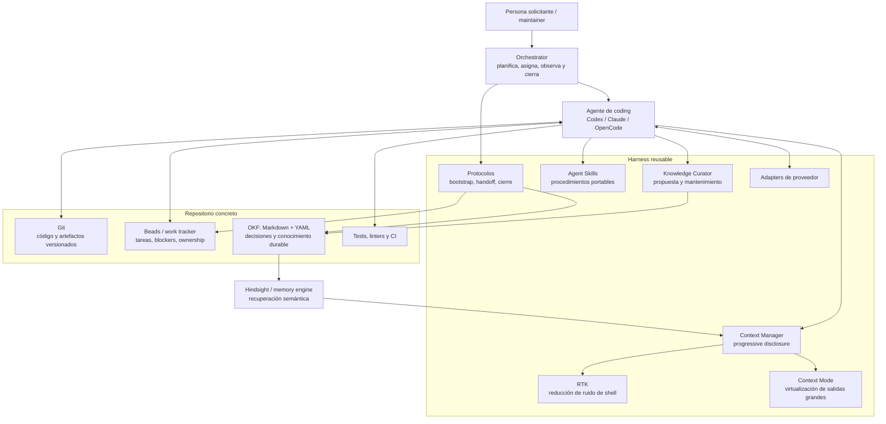
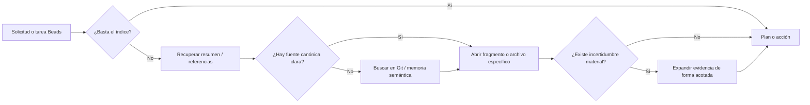
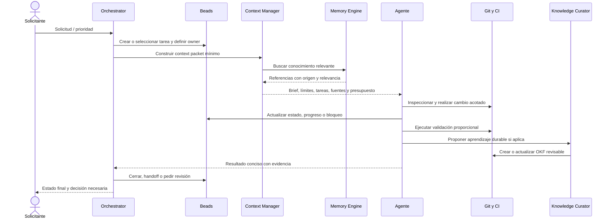
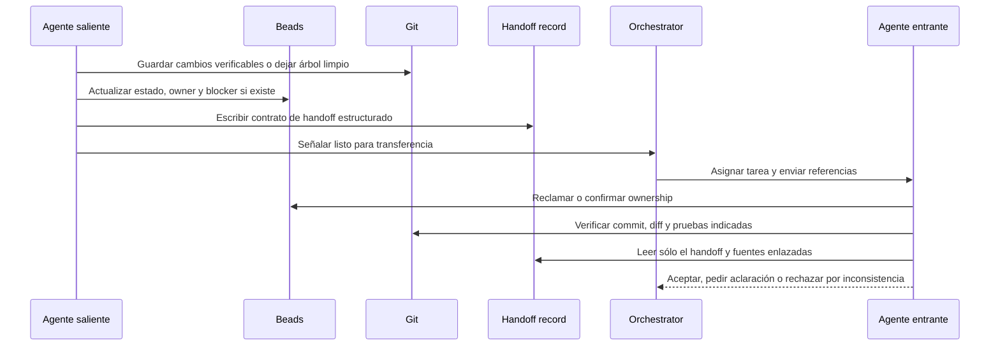
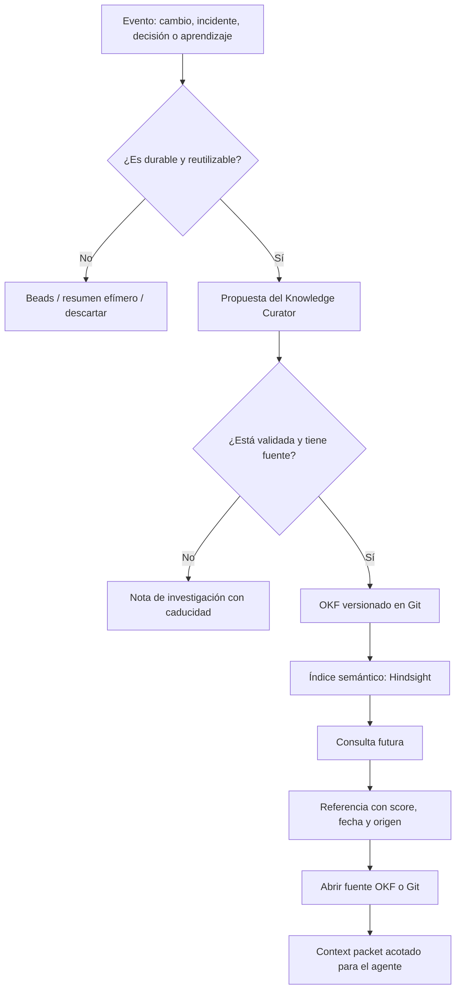
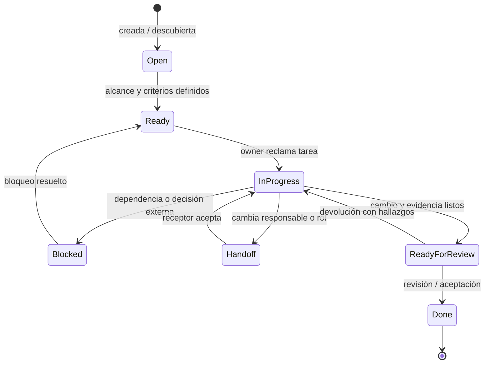

# Arquitectura reusable para un harness multiagente de coding

> Documento de referencia para diseñar, adoptar y evolucionar un harness de agentes de coding portable entre repositorios y proveedores. No presupone un lenguaje, framework, gestor de tareas ni proveedor de modelos concreto.

## 1. Resumen ejecutivo

Un **harness multiagente** es la capa operativa que permite que varios agentes de coding —humanos o de IA— trabajen sobre un mismo repositorio de manera coordinada, segura y acumulativa. Su trabajo no consiste en sustituir Git, el gestor de tareas o la documentación: consiste en conectar esas piezas con reglas claras de contexto, memoria, comunicación y ejecución.

La arquitectura propuesta se apoya en una separación estricta de responsabilidades:

| Necesidad | Mecanismo principal | Horizonte temporal | Regla fundamental |
| --- | --- | --- | --- |
| Código, configuración y cambios revisables | Git | Permanente | Git es la fuente de verdad del artefacto entregable. |
| Tareas activas, bloqueos y coordinación | Beads u otro work tracker | Segundos a horas | El estado de trabajo no vive en los prompts. |
| Decisiones, convenciones y aprendizajes verificados | OKF: Markdown + YAML | Días a años | El conocimiento durable debe ser legible, versionado y auditable. |
| Recuperación por significado | Hindsight u otro memory engine | Bajo demanda | La memoria semántica acelera la búsqueda; no reemplaza a la documentación. |
| Procedimientos reproducibles | Agent Skills | Reutilizable | Los pasos que se repiten se convierten en skills pequeñas y portables. |
| Ejecución y coordinación de agentes | Orchestrator | Por sesión | El orquestador asigna, acota, observa y cierra; no centraliza todo el conocimiento. |

La regla operativa resumida es:

```text
seconds / hours  → Beads (estado de trabajo)
days / months / years → OKF (conocimiento durable)
semantic recall → memory engine (recuperación)
source code and delivered artefacts → Git (fuente de verdad)
```

El resultado buscado es deliberadamente modesto: una sesión nueva puede comprender lo necesario, reclamar una tarea, ejecutar el cambio, dejar evidencia y terminar sin cargar transcripciones enteras ni depender de la memoria implícita de un único agente.

---

## 2. Visión y objetivos

### Visión

Construir una base que pueda instalarse o copiarse en repositorios de aplicación, bibliotecas, infraestructura, datos o monorepos; que funcione con Codex, Claude Code, OpenCode u otros proveedores; y que mantenga la colaboración útil a medida que crecen el equipo, el historial y la documentación.

El harness debe tratar a los proveedores como implementaciones intercambiables de una misma interfaz operativa. Un cambio de proveedor no debe obligar a migrar el conocimiento, el historial de trabajo, los protocolos ni la estructura del proyecto.

### Objetivos

1. **Portabilidad.** Separar el núcleo reusable de las reglas y el conocimiento propios de cada proyecto.
2. **Continuidad entre sesiones.** Retomar una tarea con estado explícito, no con transcripciones completas.
3. **Contexto pequeño y pertinente.** Cargar por índice y por necesidad, no por costumbre.
4. **Coordinación segura.** Evitar trabajo duplicado, conflictos de archivos y cambios sin dueño.
5. **Trazabilidad.** Poder responder qué cambió, por qué, quién lo hizo, qué se verificó y qué queda pendiente.
6. **Interoperabilidad.** Compartir protocolos y artefactos, no prompts privados de un proveedor.
7. **Evolución gradual.** Empezar con Markdown, Git y un work tracker; añadir recuperación semántica, automatización y métricas sólo cuando resuelvan un problema real.

### No objetivos

- No crear una “memoria omnisciente” que adivine el estado del repositorio.
- No sustituir revisiones humanas, controles de acceso ni prácticas de seguridad.
- No ejecutar múltiples agentes en paralelo por defecto.
- No imponer una taxonomía extensa ni una base de datos cuando tres archivos y un índice bastan.
- No convertir cada conversación, salida de terminal o decisión provisional en conocimiento permanente.

---

## 3. Principios de diseño

1. **Una responsabilidad, una fuente primaria.** Cada dato tiene una ubicación canónica y, si se indexa o replica, se conoce su origen.
2. **Artefactos antes que transcripciones.** Los agentes intercambian referencias, estado y decisiones estructuradas; no historiales completos de conversación.
3. **Estado explícito, contexto progresivo.** Toda sesión comienza con un resumen mínimo y obtiene más detalle sólo ante una necesidad demostrada.
4. **El proyecto no es el harness.** Las reglas portables viven en el harness; los nombres de dominios, comandos y decisiones locales viven en el proyecto.
5. **Cambios pequeños y verificables.** Preferir tareas con alcance, dueño, criterios de salida y validación explícitos.
6. **Memoria como índice, no como autoridad.** Un motor semántico puede sugerir un archivo; el archivo versionado determina la verdad.
7. **Automatización proporcional.** Automatizar primero lo repetitivo, determinista y fácil de verificar.
8. **Proveedor como adaptador.** Las diferencias de CLI, instrucciones y herramientas se encapsulan en adapters.
9. **Seguridad por defecto.** Mínimo privilegio, secretos fuera del contexto, límites de alcance y aprobación para acciones sensibles.
10. **Concisión útil.** El agente comunica resultado, evidencia, riesgo y siguiente acción; la explicación extensa se solicita, no se presupone.

---

## 4. Modelo mental y arquitectura general

El harness se compone de un núcleo agnóstico, adapters de proveedor y una capa muy pequeña específica del repositorio. El núcleo no contiene conocimiento del dominio; el proyecto no duplica protocolos universales.



### Límites arquitectónicos

- El **orquestador** decide la secuencia de trabajo y la necesidad de delegar, pero no inventa estado: lo lee de Beads, Git y OKF.
- El **agente** modifica el repositorio y produce evidencia; no escribe conocimiento durable sin validarlo ni crea tareas implícitas sin registrarlas.
- Los **adapters** traducen el protocolo común a la sintaxis o capacidades del proveedor; no cambian la semántica de una tarea.
- El **motor de memoria** recibe material curado y devuelve referencias candidatas; nunca es el único lugar donde una decisión existe.
- El **knowledge curator** propone, deduplica y mantiene conocimiento; no es un embudo burocrático que deba aprobar cada cambio de código.

---

## 5. Taxonomía de información

La mayor causa de confusión en sistemas multiagente es almacenar información correcta en la capa equivocada. Esta taxonomía evita ese problema.

| Capa | Pregunta que responde | Fuente de verdad | Ejemplos | Retención |
| --- | --- | --- | --- | --- |
| Source of truth | ¿Qué existe y qué se entregó? | Git | código, IaC, manifiestos, tests, ADRs aprobados | Permanente/versionada |
| Work state | ¿Qué se está haciendo ahora? | Beads | tarea, estado, owner, dependencia, bloqueo, siguiente paso | Corto plazo |
| Episodic memory | ¿Qué ocurrió en una sesión pasada? | Hindsight o almacén de eventos con enlace | resumen de ejecución, fallo visto, resultado de investigación | Temporal/recuperable |
| Semantic memory | ¿Qué conocimiento relacionado puede ayudar? | Índice semántico derivado de OKF/Git | similitud de decisiones, APIs, patrones, incidentes | Derivada; reindexable |
| Procedural knowledge | ¿Cómo se realiza un trabajo repetible? | Agent Skills versionadas | revisar PR, correr migración, depurar CI, curar conocimiento | Durable y portable |
| Runtime context | ¿Qué necesita este turno? | Construido al inicio de la operación | brief, archivos relevantes, presupuesto y restricciones | Efímero |

### Qué pertenece a cada capa

**Git — source of truth**

- Código, tests y configuración ejecutable.
- Especificaciones y decisiones que deben ser revisadas en pull request.
- Los documentos OKF que hayan sido aprobados.
- Evidencia pequeña y durable cuando aporta a la revisión, por ejemplo un fixture o un informe de compatibilidad.

**Beads — work state**

- Una tarea que vive hoy: `open`, `in_progress`, `blocked`, `ready_for_review`, `done`.
- Ownership temporal de una zona del código o de una decisión.
- Dependencias, handoffs y bloqueos que requieren actuación.
- Criterios de aceptación de una unidad de trabajo.

Beads no es un sustituto de un ADR ni un diario de proyecto. Cuando la tarea se completa, conserva el rastro operativo indispensable y enlaza a los artefactos finales.

**OKF — Markdown + YAML**

> Aclaración de la sesión 3 (2026-09-14): el usuario se refiere a **Open Knowledge
> Format**, la especificación presentada por Google Cloud. La expansión local
> del párrafo siguiente es un antecedente de esta idea, no el significado vigente
> ni una adopción acordada. Consultar `docs/research-open-knowledge-format.md`.

OKF significa aquí **Operational Knowledge Files**: archivos legibles por personas y máquinas, con front matter YAML para clasificación y cuerpo Markdown para el conocimiento. Son apropiados para decisiones, convenciones, arquitectura, límites, riesgos y aprendizajes repetibles.

```markdown
---
id: decision-auth-rotation
kind: decision
status: accepted
owners: [platform]
tags: [security, authentication]
created: 2026-09-10
review_after: 2027-03-10
sources:
  - ../docs/adr/0042-token-rotation.md
---

# Rotación de tokens de servicio

## Decisión

...contenido revisable y conciso...

## Consecuencias

...
```

**Hindsight o memory engine**

Es una capa opcional que indexa extractos aprobados de OKF, resultados de trabajo y metadatos. Ante una consulta, devuelve referencias con relevancia, fecha y origen. Una respuesta de memoria debe tratarse como una pista: el agente abre el artefacto fuente antes de actuar.

**Agent Skills — procedural knowledge**

Una skill captura una receta que se repite con criterios de entrada, pasos, límites y salida verificable. Ejemplos: `concise-agent`, `code-review`, `testing`, `knowledge-curation`, `release-check`.

---

## 6. Responsabilidades de los componentes

| Componente | Responsabilidad | No debe hacer |
| --- | --- | --- |
| Git | Mantener cambios, historia, revisión y artefactos definitivos | Llevar tareas en curso o sustituir documentación de descubrimiento. |
| Beads | Coordinar trabajo activo entre personas y agentes | Convertirse en una enciclopedia de arquitectura. |
| OKF | Conservar conocimiento durable, verificable y recuperable | Guardar logs crudos, hipótesis efímeras o secretos. |
| Hindsight | Recuperar contenido relevante por significado y ayudar a encontrar fuentes | Declarar la verdad sin enlace al artefacto canónico. |
| Agent Skills | Estandarizar procedimientos reutilizables | Contener decisiones de un proyecto específico sin parametrización. |
| RTK | Reducir y normalizar la salida ruidosa de comandos | Ocultar fallos, eliminar evidencia necesaria o alterar resultados. |
| Context Mode | Paginar, resumir y virtualizar salidas grandes para proteger contexto | Reemplazar el examen del archivo o log cuando éste sea necesario. |
| concise-agent | Limitar comunicación a lo que permite decidir y avanzar | Suprimir riesgos, errores, cambios o evidencia importante. |
| Orchestrator | Descomponer, asignar, medir, gobernar handoffs y cerrar sesiones | Ser una memoria implícita o ejecutar cambios fuera del alcance autorizado. |
| Knowledge Curator | Detectar aprendizajes durables, proponer OKF y mantener el índice | Burocratizar cambios triviales ni publicar conocimiento no confirmado. |
| Adapter | Traducir el contrato común a cada proveedor | Filtrar o reinterpretar el estado semántico de la tarea. |

### RTK y Context Mode

Ambos protegen la ventana de contexto, pero en niveles diferentes:

- **RTK** transforma salida de shell predecible y ruidosa en una señal estructurada: estado, errores relevantes, rutas afectadas y un enlace o artefacto para la salida completa. Es ideal para instalaciones, compilaciones, pruebas repetitivas y listados extensos.
- **Context Mode** mantiene la salida completa accesible sin inyectarla toda al modelo. Permite buscar, paginar y expandir segmentos concretos de un log, documento o resultado de herramienta.

Regla: RTK reduce primero; Context Mode conserva el detalle para una consulta posterior. Nunca se debe resumir un error hasta hacerlo irreproducible.

---

## 7. Gestión de contexto: progressive disclosure y presupuestos

### Progressive disclosure

El contexto se carga de menor a mayor costo informativo:

1. **Índice.** Mapa del repositorio, estado de la tarea, archivos candidatos y presupuesto.
2. **Resumen específico.** Sólo la sección de OKF, issue o archivo directamente relacionado.
3. **Fuente primaria.** Código, test, decisión o log preciso que permite actuar.
4. **Evidencia ampliada.** Historial, documentación completa o log entero únicamente si la hipótesis anterior no resuelve la duda.



### Paquetes de contexto

Todo agente recibe un **context packet** compacto, reproducible y con enlaces, no una transcripción. Debe contener:

- identificador de sesión, tarea y rol;
- resultado deseado y criterios de aceptación;
- restricciones de alcance, rutas y permisos;
- estado actual, owner y bloqueos de Beads;
- máximo cinco a diez referencias prioritarias;
- presupuesto de entrada/salida y condición de parada;
- handoff anterior, si existe;
- comando de validación o evidencia esperada.

### Presupuestos de entrada y salida

Los números se configuran por entorno y modelo. La siguiente política es una guía inicial, no un límite rígido:

| Tipo de trabajo | Entrada objetivo | Salida objetivo | Regla de escalamiento |
| --- | ---: | ---: | --- |
| Tarea pequeña | 4–12 k tokens | 0.5–1.5 k | Abrir más fuentes sólo ante bloqueo. |
| Investigación acotada | 12–30 k | 1–3 k | Entregar referencias y decisión, no transcripción. |
| Cambio transversal | 20–50 k | 1–4 k | Dividir en subtareas antes de superar el límite. |
| Handoff | 0.5–2 k | 0.5–1 k | Sólo estado, decisión, evidencia y próximo paso. |
| Curación de conocimiento | 2–10 k | 0.5–2 k | Publicar únicamente información durable validada. |

Al alcanzar 70 % del presupuesto de entrada, el agente debe reevaluar el plan. Al alcanzar 85 %, debe elegir entre terminar una unidad verificable, realizar un handoff o solicitar una aclaración. No debe seguir acumulando contexto “por si acaso”.

### Política `concise-agent`

La concisión es una interfaz operativa, no una estética. Por defecto, una actualización usa este orden:

1. **Resultado:** qué se completó, encontró o bloqueó.
2. **Evidencia:** archivo, prueba, tarea o comando relevante.
3. **Riesgo o decisión:** sólo si cambia la acción siguiente.
4. **Siguiente paso:** una acción concreta, o “sin acciones pendientes”.

Ejemplo:

```text
Implementado el validador de fechas y añadidos 6 casos límite.
Evidencia: src/date/validate.ts, tests/date/validate.test.ts; suite focalizada OK.
Pendiente: la tarea BD-142 sigue bloqueada por la definición del formato legado.
```

Evitar: preámbulos largos, narrar cada comando, repetir el pedido, listar archivos no afectados y explicar teoría conocida. Nunca omitir una prueba fallida, un cambio irreversible, un riesgo de seguridad o una suposición que altere el alcance.

---

## 8. Flujos operativos

### 8.1 Flujo de una sesión



### 8.2 Flujo de handoff entre agentes

Un handoff no traslada el “pensamiento” completo de un agente. Traslada el estado mínimo que permite al siguiente continuar sin redescubrir lo ya validado.



Un agente entrante puede rechazar un handoff si el árbol de trabajo no coincide con la evidencia, no existe owner claro, falta un criterio de éxito o el alcance supera su presupuesto. Rechazarlo no es un fallo: evita que la ambigüedad se propague.

### 8.3 Flujo de conocimiento y contexto



---

## 9. Protocolo estructurado agent-to-agent

El formato común evita que el handoff dependa de la elocuencia del proveedor. Puede almacenarse como comentario de Beads, archivo efímero dentro de `.agent/handoffs/` o mensaje de orquestación. Los campos obligatorios son pequeños y verificables.

```yaml
schema: harness.handoff/v1
handoff_id: hof-20260910-014
task_id: BD-142
from:
  agent_id: codex-implementation-01
  role: implementer
to:
  role: reviewer
status: ready_for_review # accepted | blocked | ready_for_review | done
objective: Validar fechas de inicio y fin en la API de reservas.
scope:
  allowed_paths:
    - src/reservations/
    - tests/reservations/
  excluded_paths:
    - migrations/
work_completed:
  - Se añadió validación de orden cronológico.
  - Se añadieron pruebas de bordes de zona horaria.
evidence:
  commits: ["abc1234"]
  files:
    - src/reservations/validate.ts
    - tests/reservations/validate.test.ts
  verification:
    - command: "npm test -- reservations"
      result: pass
decisions:
  - decision: Rechazar fin igual al inicio.
    source: knowledge/decisions/reservation-boundaries.md
open_questions:
  - ¿El cliente legado permite fechas sin zona horaria?
risks:
  - La ruta pública aún acepta el formato legado; no se modificó por alcance.
next_action: Revisar compatibilidad de serialización y aprobar o devolver comentarios.
context_refs:
  - beads:BD-142
  - knowledge/decisions/reservation-boundaries.md
budget_hint:
  input_tokens: 8000
  output_tokens: 1000
```

### Reglas del protocolo

- Cada afirmación importante debe enlazar a una fuente, archivo o prueba.
- El campo `objective` describe el resultado, no la secuencia de comandos ejecutados.
- `scope` declara tanto lo permitido como lo excluido; reduce conflictos entre agentes paralelos.
- `open_questions` contiene preguntas accionables, nunca una lista de dudas genéricas.
- `risks` describe impactos, no temores abstractos.
- Si no se hizo validación, se declara explícitamente con motivo y riesgo.
- Los handoffs caducan cuando cambia materialmente el estado de Git o de la tarea.

---

## 10. Lifecycle de una tarea



### Estados y criterios mínimos

| Estado | Significado | Campo indispensable |
| --- | --- | --- |
| `open` | Existe una necesidad, pero falta definición | origen o motivo de creación |
| `ready` | Se puede ejecutar sin ambigüedad material | objetivo, alcance, aceptación y prioridad |
| `in_progress` | Una persona o agente trabaja activamente | owner y momento de inicio |
| `blocked` | No puede avanzar por una dependencia real | bloqueo, responsable y condición de desbloqueo |
| `handoff` | Se transfiere la continuidad | contrato estructurado y receptor esperado |
| `ready_for_review` | Hay una unidad verificable | diff/commit, pruebas y riesgos |
| `done` | Cumple aceptación y no quedan acciones de la tarea | evidencia final y enlaces |

No se debe reclamar una tarea que no tenga una condición de éxito. Si una tarea se descubre demasiado grande, se divide antes de añadir más agentes.

---

## 11. Bootstrap y cierre de sesión

### Bootstrap de sesión

Una sesión empieza con una carga deliberadamente pequeña:

1. Verificar estado de Git: rama, cambios pendientes y políticas del repositorio.
2. Leer las instrucciones raíz del proveedor y el proyecto (`AGENTS.md`, `CLAUDE.md` u otras equivalentes), pero no cargar documentación indiscriminada.
3. Seleccionar o crear la tarea en Beads; confirmar owner, prioridad, alcance y criterio de salida.
4. Construir el context packet con el índice del proyecto, referencias prioritarias y presupuesto.
5. Consultar Hindsight sólo con una pregunta concreta; abrir las fuentes que devuelva antes de confiar en ellas.
6. Declarar un plan corto: máximo los pasos necesarios para la unidad de trabajo.
7. Antes de modificar, detectar conflictos de ownership, restricciones de rutas y acciones que requieren aprobación.

Ejemplo de brief inicial:

```text
Tarea: BD-142 — validar fechas de reservas.
Objetivo: impedir rangos inválidos sin cambiar el contrato de la API.
Alcance: src/reservations/** y tests/reservations/**.
Éxito: pruebas existentes y nuevos casos de límite pasan.
Referencias: beads:BD-142; knowledge/decisions/reservation-boundaries.md.
Presupuesto: 10k entrada / 1.5k salida. Si surge una migración, bloquear y hacer handoff.
```

### Cierre de sesión

El cierre no consiste sólo en terminar de responder. Antes de abandonar una sesión, el agente debe:

1. Dejar los cambios en un estado seguro: commit verificable, diff intencional o árbol limpio según la política del repositorio.
2. Registrar el estado real de la tarea en Beads.
3. Adjuntar evidencia de validación, incluidas las verificaciones no ejecutadas.
4. Emitir un handoff si queda trabajo, un bloqueo si depende de una decisión externa, o cierre si se cumplió la aceptación.
5. Proponer curación sólo cuando haya conocimiento durable; no convertir el resumen de cierre en un OKF automático.
6. Responder de forma concisa con resultado, evidencia, riesgo y siguiente acción.

---

## 12. Knowledge Curator

El knowledge curator es un rol, una skill o un agente especializado. Su finalidad es convertir hallazgos repetibles en conocimiento consultable, sin llenar el repositorio de notas desactualizadas.

### Cuándo curar

Proponer una entrada OKF si el hallazgo cumple al menos dos de estos criterios:

- afecta decisiones futuras o más de un componente;
- ya produjo una regresión, incidente o coste de investigación;
- define una convención que otros contribuidores deben seguir;
- contiene una integración, restricción o límite externo con vigencia razonable;
- será difícil de redescubrir desde el código;
- se reutiliza entre tareas o repositorios.

### Cuándo no curar

- progreso de una tarea aún abierta;
- salida cruda de terminal;
- hipótesis sin validar;
- decisión local evidente en un diff pequeño;
- información sensible;
- documentación de una dependencia que ya posee documentación oficial estable.

### Proceso

1. Detectar una posible lección desde tareas completadas, revisiones, incidentes o handoffs.
2. Localizar la fuente primaria y verificar que la conclusión es correcta.
3. Buscar duplicados por ID, etiquetas y similitud semántica.
4. Proponer una entrada corta con tipo, alcance, evidencia, dueño y fecha de revisión.
5. Someterla a la revisión normal de Git cuando el impacto lo amerite.
6. Actualizar el índice y, si existe, reindexar la memoria semántica.
7. Retirar o revisar conocimiento que haya alcanzado su fecha de caducidad.

Tipos sugeridos de OKF:

```text
decision     — decisión y consecuencias
architecture — límites, componentes y relaciones
convention   — regla de implementación o colaboración
playbook     — operación o diagnóstico de proyecto
pitfall      — error recurrente y prevención
integration  — contrato con sistema externo
learning     — aprendizaje validado de una tarea/incidente
```

---

## 13. Estructura reusable del harness

Esta estructura representa el paquete reusable. Puede publicarse como repositorio propio, plantilla, paquete o conjunto de archivos sincronizables.

```text
agent-harness/
├── README.md
├── harness.config.schema.json
├── core/
│   ├── orchestration/
│   │   ├── task-lifecycle.md
│   │   ├── bootstrap.md
│   │   └── closure.md
│   ├── context/
│   │   ├── context-packet.schema.yaml
│   │   ├── disclosure-policy.md
│   │   └── budgets.md
│   ├── memory/
│   │   ├── memory-contract.md
│   │   └── indexing-policy.md
│   ├── protocols/
│   │   ├── handoff.schema.yaml
│   │   ├── concise-response.md
│   │   └── ownership.md
│   └── governance/
│       ├── security.md
│       └── evaluation.md
├── skills/
│   ├── concise-agent/
│   │   └── SKILL.md
│   ├── code-review/
│   │   └── SKILL.md
│   ├── testing/
│   │   └── SKILL.md
│   ├── knowledge-curation/
│   │   └── SKILL.md
│   └── session-bootstrap/
│       └── SKILL.md
├── adapters/
│   ├── codex/
│   │   ├── AGENTS.md.template
│   │   └── adapter.yaml
│   ├── claude/
│   │   ├── CLAUDE.md.template
│   │   └── adapter.yaml
│   └── opencode/
│       ├── instructions.template.md
│       └── adapter.yaml
├── templates/
│   ├── project.yaml
│   ├── knowledge-entry.md
│   ├── handoff.yaml
│   └── project-instructions.md
└── scripts/
    ├── doctor
    ├── sync
    └── validate-config
```

### Estructura mínima que adopta cada proyecto

El proyecto debe añadir sólo lo indispensable para describirse. Sus rutas pueden variar, pero se recomienda un contrato estable:

```text
my-project/
├── src/
├── tests/
├── docs/
├── knowledge/
│   ├── index.md
│   ├── decisions/
│   ├── architecture/
│   ├── conventions/
│   ├── playbooks/
│   └── pitfalls/
├── .agent/
│   ├── project.yaml
│   ├── handoffs/              # opcional, efímero y excluible si corresponde
│   └── local/                 # estado no versionado y secretos: gitignored
├── harness.config.yaml
├── AGENTS.md                  # adapter Codex, si aplica
├── CLAUDE.md                  # adapter Claude Code, si aplica
└── README.md
```

Para un proyecto pequeño, `knowledge/index.md`, `.agent/project.yaml`, `harness.config.yaml` y un archivo de instrucciones del proveedor son suficientes. No crear cada directorio vacío sólo porque el esquema lo menciona.

---

## 14. Configuración de ejemplo

El archivo `harness.config.yaml` declara contratos y rutas, no contiene secretos ni prompts extensos.

```yaml
schema: harness.config/v1
project:
  name: my-project
  type: application
  default_branch: main

sources:
  git:
    code_of_truth: true
  work_tracker:
    provider: beads
    task_prefix: BD
  knowledge:
    root: knowledge
    index: knowledge/index.md
    format: okf-markdown-yaml
  memory:
    provider: hindsight # none | hindsight | compatible-provider
    mode: retrieval_only
    index_sources:
      - knowledge/**
      - docs/adr/**
    exclude:
      - .env*
      - .agent/local/**
      - '**/secrets/**'

context:
  progressive_disclosure: true
  max_primary_references: 8
  budgets:
    small_task: { input_tokens: 12000, output_tokens: 1500 }
    research: { input_tokens: 30000, output_tokens: 3000 }
    handoff: { input_tokens: 2000, output_tokens: 1000 }
  rtk:
    enabled: true
    preserve_raw_output: true
  context_mode:
    enabled: true
    page_large_outputs: true

coordination:
  require_owner_for_in_progress: true
  require_handoff_for_owner_change: true
  require_clean_or_explicit_diff_on_close: true
  parallelism:
    default_max_agents: 1
    require_non_overlapping_paths: true

knowledge:
  curator:
    enabled: true
    require_source_links: true
    review_after_days: 180
  allowed_kinds: [decision, architecture, convention, playbook, pitfall, integration, learning]

governance:
  secrets_in_context: forbidden
  protected_paths:
    - .github/workflows/**
    - infra/production/**
  approval_required_for:
    - deploy_production
    - rotate_credentials
    - change_access_policy
    - delete_data

adapters:
  codex:
    enabled: true
    instructions: AGENTS.md
  claude:
    enabled: true
    instructions: CLAUDE.md
  opencode:
    enabled: true
    instructions: .opencode/instructions.md
```

---

## 15. Adapters de proveedor: Codex, Claude Code y OpenCode

El adapter es una capa de traducción. Todos los proveedores reciben el mismo objetivo, context packet, esquema de handoff, política de seguridad y criterio de cierre. Lo que cambia es el formato de instrucciones, la forma de ejecutar tools y las capacidades disponibles.

| Contrato común | Codex | Claude Code | OpenCode |
| --- | --- | --- | --- |
| Instrucciones de repositorio | `AGENTS.md` | `CLAUDE.md` | archivo de instrucciones configurado |
| Skill portable | `SKILL.md` o mecanismo equivalente | skill/comando equivalente | prompt/comando/skill equivalente |
| Context packet | prompt o archivo referenciado | prompt o archivo referenciado | prompt o archivo referenciado |
| Handoff | YAML/Beads/Git | YAML/Beads/Git | YAML/Beads/Git |
| Estado de trabajo | Beads u otro tracker externo | el mismo tracker | el mismo tracker |
| Fuente de verdad | Git y OKF | Git y OKF | Git y OKF |

### Reglas para adapters

1. El archivo específico del proveedor debe ser breve y enlazar al contrato común, no copiar toda la arquitectura.
2. El adapter puede declarar capacidades reales: uso de worktrees, subagentes, navegador, sandbox o skills.
3. Una ausencia de capacidad debe degradar con claridad: por ejemplo, si no existe Hindsight, usar el índice Markdown y búsqueda textual.
4. Los identifiers, rutas y esquemas compartidos no se renombran por proveedor.
5. Los prompts de proveedor no almacenan secretos, estado transitorio ni documentación del dominio que ya pertenece a OKF.

Ejemplo de un adapter mínimo para cualquier proveedor:

```markdown
# Instrucciones del adapter

1. Antes de editar, lee `.agent/project.yaml` y reclama la tarea indicada en el work tracker.
2. Construye contexto por progressive disclosure; no cargues todo `knowledge/`.
3. Usa el esquema `harness.handoff/v1` al cambiar de responsable.
4. Git y OKF son fuentes canónicas; la memoria semántica sólo devuelve referencias.
5. Responde con la política `concise-agent` y actualiza el estado de trabajo al cerrar.
```

---

## 16. Matriz de decisión: OKF, Beads o memoria

| Pregunta | Guardar en | Ejemplo | Motivo |
| --- | --- | --- | --- |
| ¿Quién está implementando algo hoy y qué la bloquea? | Beads | “BD-142 bloqueada por decisión de compatibilidad” | Cambia pronto y exige coordinación. |
| ¿Qué decisión arquitectónica fue aceptada y por qué? | OKF + Git | “Usar colas con entrega al menos una vez” | Debe sobrevivir a personas y sesiones. |
| ¿Qué archivos probablemente tratan un patrón parecido? | Memoria semántica | referencias a dos decisiones y un playbook | Es una búsqueda, no un hecho canónico. |
| ¿Cómo se revisa un cambio de esquema? | Agent Skill | `database-migration-review` | Procedimiento repetible y portable. |
| ¿Qué salió en 20 000 líneas de compilación? | RTK/Context Mode, con enlace | error y rutas relevantes | Es evidencia operativa voluminosa. |
| ¿Qué commit implementó el cambio? | Git y enlace desde Beads | `abc1234` | El historial versionado es autoritativo. |
| ¿Qué aprendimos al depurar tres veces el mismo incidente? | OKF tipo `pitfall` o `playbook` | causa, diagnóstico y prevención | Ahorra investigación futura. |

Una heurística simple:

```text
¿Cambia en horas?                     → Beads.
¿Debe explicarse/revisarse en meses?  → OKF versionado.
¿Sólo necesito encontrarlo mejor?     → índice de memoria.
¿Es un paso repetible?                → Skill.
¿Es código o evidencia de entrega?    → Git.
```

---

## 17. Seguridad y gobernanza

Un harness aumenta la velocidad de ejecución; por ello debe aumentar también la claridad sobre autoridad y límites.

### Controles mínimos

- **Mínimo privilegio:** cada agente recibe sólo las herramientas, rutas y credenciales necesarias para su tarea.
- **Secretos fuera del contexto:** usar gestores de secretos y variables inyectadas; excluir `.env`, claves, dumps y configuraciones sensibles del índice y del memory engine.
- **Aprobaciones explícitas:** despliegues productivos, borrado de datos, cambios de identidad/permisos, rotación de credenciales y gastos externos requieren confirmación humana definida.
- **Rutas protegidas:** políticas especiales para CI/CD, infraestructura productiva, dependencias de seguridad y archivos de gobierno.
- **Aislamiento de ejecución:** preferir worktrees o entornos aislados cuando haya tareas concurrentes; nunca mezclar cambios no relacionados en un mismo árbol.
- **Trazabilidad:** cada cambio debe poder relacionarse con tarea, owner, commit y validación.
- **Confianza en herramientas externas:** toda respuesta de integración, búsqueda o memoria se considera entrada no confiable hasta verificar su fuente.
- **Retención y privacidad:** definir cuánto tiempo viven los resúmenes episódicos y quién puede consultar la memoria semántica.

### Gobernanza de conocimiento

- Todo OKF tiene `id`, tipo, estado y propietario lógico.
- Las entradas con consecuencias técnicas deben enlazar a su fuente primaria.
- Las decisiones reemplazadas se marcan como `superseded`, sin borrarlas silenciosamente.
- Las entradas con fecha de revisión se revisan o archivan; no se dejan como verdades eternas.
- No indexar información regulada, personal o secreta sin una política explícita de clasificación y acceso.

---

## 18. Observabilidad y evaluación

El propósito de medir no es vigilar a los agentes; es descubrir fricción, contexto inútil y fallos de coordinación.

### Señales operativas

| Métrica | Qué indica | Señal de alerta |
| --- | --- | --- |
| Tiempo de bootstrap | Facilidad para iniciar una tarea | sesiones que gastan mucho tiempo buscando contexto básico |
| Reapertura de tareas | Calidad de la definición y validación | tareas “done” que vuelven por falta de aceptación |
| Tasa de handoff aceptado | Calidad del contrato de transferencia | muchos handoffs rechazados o reexplicados |
| Conflictos de ownership | Eficacia de coordinación | agentes editando las mismas rutas sin acuerdo |
| Ratio de contexto útil | Calidad de retrieval y disclosure | archivos cargados que no influyen en la decisión |
| Tiempo hasta evidencia | Velocidad para producir una unidad verificable | trabajo largo sin tests, diff ni resultado |
| Duplicados de conocimiento | Salud de OKF | decisiones o playbooks contradictorios |
| Fallos de validación post-cierre | Calidad técnica | CI o revisión detecta errores recurrentes |

### Evaluación cualitativa

Revisar periódicamente una muestra de sesiones y preguntar:

- ¿El agente podía saber qué hacer sin leer todo el repositorio?
- ¿Cada handoff habría permitido continuar a otro proveedor?
- ¿La memoria apuntó a la fuente correcta o generó confianza falsa?
- ¿Los resúmenes fueron suficientemente concisos sin ocultar riesgos?
- ¿Se creó conocimiento durable sólo cuando tenía valor futuro?
- ¿La automatización redujo pasos reales o añadió mantenimiento?

Los logs de observabilidad deben registrar metadatos y referencias, no prompts completos ni secretos, salvo una política de auditoría explícita y aprobada.

---

## 19. Anti-patrones y overengineering que evitar

| Anti-patrón | Por qué falla | Alternativa mínima |
| --- | --- | --- |
| Un prompt raíz gigantesco con todo el proyecto | Se vuelve obsoleto, consume contexto y no es navegable | Índice + context packet + disclosure progresivo. |
| Compartir transcripciones entre agentes | Aumenta ruido, filtra supuestos y no da estado verificable | Handoff YAML con enlaces a fuentes. |
| Usar Hindsight como base de verdad | Un índice puede quedar desactualizado o recuperar contenido incorrecto | Abrir siempre la fuente Git/OKF referenciada. |
| Guardar cada hallazgo como OKF | Genera cementerio documental y costes de mantenimiento | Curar sólo conocimiento durable y reutilizable. |
| Usar Beads como wiki | El estado activo se mezcla con decisiones históricas | Enlazar desde Beads a OKF y Git. |
| Multiplicar agentes por defecto | Produce conflictos, contexto duplicado y sobrecoordinación | Un agente por unidad; paralelizar sólo rutas/objetivos independientes. |
| Crear un protocolo por proveedor | Rompe la portabilidad | Un contrato común y adapters delgados. |
| Diseñar una ontología extensa antes de tener casos | Paraliza adopción y no refleja el trabajo real | Empezar con cinco tipos de conocimiento y evolucionar por evidencia. |
| Automatizar indexación o curación sin revisión | Propaga información débil a todas las sesiones | Propuesta automática, publicación y revisión explícitas. |
| Ocultar por completo salidas largas | Puede borrar el único indicio de un fallo | RTK resume y Context Mode conserva acceso al bruto. |
| Medir cantidad de mensajes o tokens como productividad | Incentiva comportamiento superficial | Medir evidencia, reaperturas, conflicto y tiempo de bootstrap. |

---

## 20. Roadmap de adopción: MVP → v2 → v3

### MVP: disciplina y artefactos mínimos

Objetivo: hacer trabajo reproducible sin dependencias nuevas obligatorias.

- `harness.config.yaml` con rutas y reglas mínimas.
- Un archivo de instrucciones breve por proveedor usado.
- Git como fuente de verdad; work tracker existente o Beads para tareas, owners y blockers.
- `knowledge/index.md` y dos o tres tipos de OKF: decisiones, convenciones y pitfalls.
- Context packet manual y protocolo `handoff/v1`.
- Política concise-agent y bootstrap/cierre básicos.
- Validación con pruebas existentes; sin dashboard ni memoria vectorial.

**Criterio de salida:** una tarea puede pasar de una sesión a otra usando sólo Beads, Git, dos referencias de conocimiento y el handoff estructurado.

### v2: recuperación, skills y automatización segura

Objetivo: reducir investigación repetida y fricción operativa.

- Hindsight o memory engine compatible indexando sólo fuentes permitidas.
- Skills reutilizables para bootstrap, pruebas, revisión y curación.
- RTK para comandos ruidosos y Context Mode para consultas paginadas.
- Validación de esquema para configuración, OKF y handoffs.
- Adaptadores iniciales para Codex, Claude Code y OpenCode.
- Métricas ligeras: tiempo de bootstrap, reaperturas, bloqueos y handoffs.

**Criterio de salida:** el retrieval devuelve referencias de calidad y la sesión no necesita cargar documentación completa para tareas habituales.

### v3: orquestación madura y gobierno multi-repositorio

Objetivo: coordinar trabajo paralelo limitado entre repositorios sin perder control.

- Orquestador con programación por capacidades, rutas y dependencias.
- Worktrees o entornos aislados automatizados para tareas independientes.
- Sincronización versionada de harness y skills entre repositorios.
- Evaluaciones periódicas de retrieval, calidad de handoff y seguridad.
- Catálogo de knowledge packages compartibles con ownership y semver.
- Política de acceso y auditoría por organización.

**Criterio de salida:** la adopción de un nuevo repositorio es predecible, el proveedor puede cambiar sin migrar la información y la concurrencia no aumenta conflictos.

---

## 21. Checklist para adoptar el harness en un repositorio existente

### Diagnóstico inicial

- [ ] Inventariar instrucciones existentes: `AGENTS.md`, `CLAUDE.md`, README, hooks, configuración de herramientas y CI.
- [ ] Identificar qué información se carga siempre y si realmente es necesaria.
- [ ] Distinguir tareas activas, documentación durable, scripts repetitivos y memoria informal.
- [ ] Localizar documentación duplicada, contradicciones y prompts gigantes.
- [ ] Identificar comandos ruidosos y artefactos grandes que justifican RTK o Context Mode.
- [ ] Definir qué rutas y acciones requieren aprobación humana.

### Primera instalación

- [ ] Añadir `harness.config.yaml` con rutas reales y sin secretos.
- [ ] Añadir `.agent/project.yaml` con descripción breve del proyecto y comandos de validación.
- [ ] Crear `knowledge/index.md` y migrar únicamente decisiones/convenios claramente valiosos.
- [ ] Configurar el tracker para registrar owner, estado, bloqueo y criterios de salida.
- [ ] Instalar un adapter breve para cada proveedor efectivamente usado.
- [ ] Acordar el esquema `handoff/v1` y practicarlo en una tarea pequeña.
- [ ] Activar la política concise-agent para las actualizaciones normales.

### Validación antes de ampliar

- [ ] Ejecutar tres a cinco tareas reales sin añadir memoria semántica.
- [ ] Medir si el bootstrap, los handoffs y la recuperación manual ya son consistentes.
- [ ] Confirmar que Git, Beads y OKF no se están usando para lo mismo.
- [ ] Añadir Hindsight sólo si buscar conocimiento relevante sigue siendo un coste repetido.
- [ ] Añadir agentes paralelos sólo cuando haya unidades independientes y ownership de rutas claro.

---

## 22. CLI futura

Una CLI debe hacer visibles los contratos; no esconder procesos complejos. Estos comandos son una dirección posible:

```bash
# Inicializa los archivos mínimos y el adapter seleccionado.
harness init --adapter codex --work-tracker beads

# Revisa configuración, rutas, esquemas, referencias rotas y riesgos comunes.
harness doctor

# Sincroniza core, templates y skills sin sobrescribir cambios locales sin confirmación.
harness sync --check

# Genera un context packet y abre/ejecuta un proveedor bajo el contrato común.
harness agent codex --task BD-142
harness agent claude --task BD-142 --role reviewer
harness agent opencode --task BD-142

# Valida y registra una transferencia entre responsables.
harness handoff validate .agent/handoffs/hof-20260910-014.yaml

# Propone conocimiento a partir de una tarea completada; no publica sin revisión.
harness knowledge propose --task BD-142

# Reindexa sólo las fuentes permitidas para la memoria semántica.
harness memory sync
```

Comportamientos esperados:

- `init` nunca destruye archivos existentes; crea plantillas y muestra diferencias.
- `doctor` falla de manera accionable: indica archivo, regla y cambio mínimo.
- `sync --check` reporta divergencias; `sync --apply` requiere una acción explícita.
- `agent` no inicia trabajo con una tarea sin owner/aceptación, salvo que se cree con ese mismo comando.
- `memory sync` omite patrones excluidos, muestra el número de fuentes indexadas y no envía secretos.

---

## 23. Ejemplos concretos

### Ejemplo A: corrección pequeña con un agente

**Caso:** un campo opcional produce un error al serializar.

1. Se crea una tarea Beads con alcance `src/api/**`, criterio “la respuesta no falla cuando `middleName` es nulo” y owner.
2. El agente lee el índice, la tarea y el archivo de convención de serialización; no carga todo `knowledge/`.
3. Cambia el serializador y añade una prueba de regresión.
4. RTK reporta que la suite focalizada pasó y Context Mode deja disponible el log completo.
5. El agente actualiza la tarea con commit, pruebas y resultado conciso.
6. No se crea un OKF: la solución es local, evidente en el diff y no representa aprendizaje durable.

### Ejemplo B: cambio transversal con handoff

**Caso:** migrar una política de reintentos que afecta API, worker y observabilidad.

1. El orquestador crea una épica y tres tareas con rutas no solapadas.
2. Antes de implementar, se consulta el índice y se recuperan dos decisiones previas sobre idempotencia. El agente abre las fuentes originales.
3. El primer agente implementa API y deja un handoff `ready_for_review`; declara que no cambió migraciones ni contrato público.
4. El revisor verifica el commit, el diff y la prueba indicada; acepta el handoff.
5. Al completar las tres tareas, el curator propone una decisión OKF que documenta la política consolidada y sus consecuencias.
6. El motor de memoria indexa la decisión aprobada, no los tres transcripts ni los logs de pruebas.

### Ejemplo C: una sesión encuentra un bloqueo

**Caso:** una dependencia externa documenta dos límites de cuota contradictorios.

1. El agente no elige arbitrariamente un número ni añade una nota permanente.
2. Marca la tarea como `blocked` en Beads con enlaces a ambas fuentes y la pregunta concreta que necesita respuesta.
3. Emite un resumen conciso y no consume más contexto intentando reconciliar información no verificable.
4. Cuando se decide el límite correcto, se retoma la tarea y se crea un OKF de tipo `integration` si ese límite afectará futuros cambios.

---

## 24. Criterios de éxito del harness

El harness está funcionando cuando:

- una persona o agente nuevo puede empezar una tarea pequeña con menos de diez referencias relevantes;
- una tarea activa siempre tiene owner, objetivo, alcance y condición de cierre;
- cambiar de Codex a Claude Code u OpenCode no exige reescribir la información de trabajo;
- los handoffs se aceptan con evidencia y no requieren compartir conversaciones completas;
- las decisiones importantes existen en Git/OKF y la memoria semántica sólo ayuda a encontrarlas;
- la mayor parte de las actualizaciones cabe en cuatro líneas sin perder información crítica;
- agregar un nuevo repositorio exige parametrización, no copiar y editar decenas de prompts;
- la automatización disminuye investigación o errores reales y no crea otra plataforma que mantener.

## 25. Conclusión

La arquitectura no depende de que un agente “recuerde mejor”. Depende de que el sistema sepa **dónde vive cada tipo de verdad**, cómo se recupera con bajo coste y cómo se entrega a la siguiente sesión de forma verificable.

Un buen harness multiagente no es una capa de complejidad sobre el repositorio. Es un conjunto pequeño de contratos que convierte trabajo efímero en estado claro, conocimiento durable y cambios revisables. Empezar por Git, Beads, OKF, context packets y handoffs estructurados permite obtener la mayor parte del valor. Las capas de memoria, automatización y orquestación avanzada se incorporan después, cuando los datos de uso justifiquen su coste.
