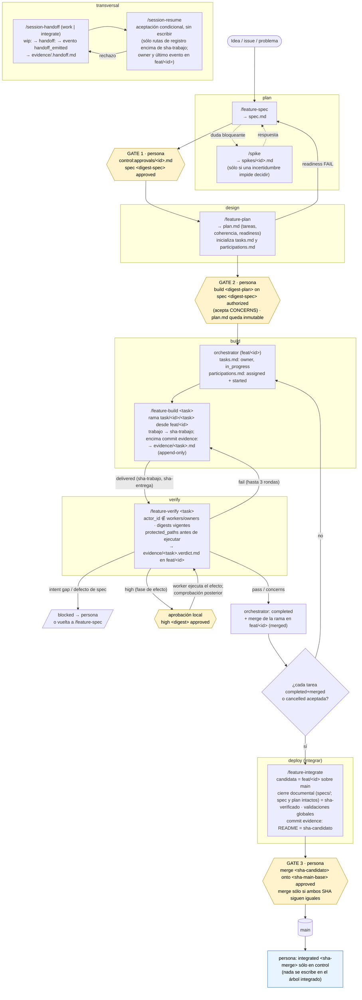
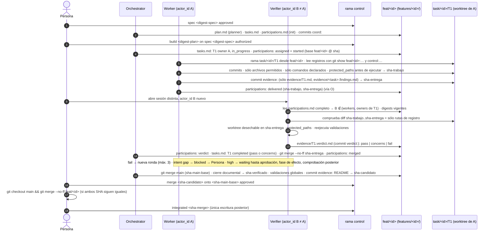

# Skills del flujo de construcción de T800R

Catálogo de las ocho skills con las que la persona y los agentes construyen
T800R y el repositorio piloto (IDP con Backstage) feature a feature. La fuente
de verdad es [workflow-construccion.md](../docs/workflow-construccion.md) (v4,
aceptado el 2026-09-30 en [S12](../docs/definition/session-12-validation-convergence.md),
fila «Flujo de construcción por feature y skills (v4)»; v4.1 del 2026-10-05
incorpora las correcciones de la revisión Codex
[skills-codex-2026-10-05.md](../docs/reviews/skills-codex-2026-10-05.md)). Este
README explica qué skills existen, cómo encajan en el flujo y de qué referencias
se tomó cada práctica; no sustituye al flujo ni a los ocho `SKILL.md`, que son
la instrucción operativa de cada skill.

## 1. Qué es este directorio

- **Ubicación canónica neutral.** Cada skill vive en `skills/<skill>/SKILL.md`,
  con `name`, `description`, cuerpo breve y `references/` bajo demanda
  (workflow §5). Es la única copia con autoridad.
- **Proyección a proveedores.** Se proyecta a `.claude/skills/`, `.opencode/` y
  la configuración de Codex **sólo tras comprobar** que cada proveedor la
  ejecuta (experimento E4). Un formato común no garantiza ejecución portable:
  rutas, activación y metadatos difieren
  ([research-agent-skills.md](../docs/research-agent-skills.md) l. 33-39 y
  tabla l. 58-63). Para que la proyección no rompa las referencias, cada
  `SKILL.md` cita lo que está fuera de su directorio como **ruta desde la raíz
  del repositorio** (`docs/workflow-construccion.md`, `skills/README.md`), sin
  enlace relativo; sólo `references/` de la propia skill se enlaza en
  relativo, porque el directorio se proyecta entero. E4 comprueba que cada
  proveedor resuelve esas rutas desde la raíz (workflow §5). **Paquete de
  proyección al piloto** (workflow §5): `skills/` completo,
  `docs/workflow-construccion.md`, este README (con la primera línea
  `Proyectado desde T800R @ <sha>`) y un `policy.yaml` provisional con las
  `protected_paths` de workflow §4.3, en las mismas rutas del repositorio
  destino; las referencias al canon (`docs/definition/`, `docs/research-*`,
  `ideas/`) no se copian y se resuelven en el checkout de T800R de ese SHA.
- **Las skills no conceden permisos.** Orientan y comprueban lo mecánico; lo que
  un actor puede tocar lo fijan el plan autorizado y el `policy.yaml`
  (workflow §5; [S04](../docs/definition/session-04-operating-cycle.md) l. 112;
  [research-ai-native-sdlc-playbook.md](../docs/research-ai-native-sdlc-playbook.md) l. 63).
- **Cambiar una skill es `high`.** Una skill modificada no aprueba su propia
  activación; skills y configuración de agentes son `protected_paths` (workflow
  §5 y §4.3). Son la versión 0 de lo que T800R instalará en otros repositorios.

## 2. El flujo en una página

Antes del diagrama, dos piezas que aparecen en él: la **rama huérfana `control`**
es una rama de Git sin historia común con `main` donde sólo la persona registra
aprobaciones (`control:approvals/<feature-id>.md`); está separada de `main` y de
la rama candidata para que registrar una aprobación no cambie el SHA de nada
aprobado (workflow §2). Un **digest** es un hash del contenido de `spec.md` o
`plan.md` que la aprobación cita para identificar exactamente qué se aprobó. Las
skills lo fijan como `git hash-object <archivo>` sobre el archivo guardado; el
digest nunca se escribe dentro del archivo (cambiaría el hash).

Y el **modelo de coordinación** (workflow §2.1): además de `control`, cada
feature tiene la rama **`feat/<id>`**, de coordinación y candidata, donde viven
`features/<id>/` (spec, plan, `tasks.md`, `participations.md`, veredictos) y a
la que el orchestrator integra cada tarea verificada; cada tarea trabaja en
`task/<id>/T<n>`, nacida de `feat/<id>`. Los registros se leen de su rama
(`git show feat/<id>:features/<id>/tasks.md`), no del worktree. La evidencia,
el handoff y el README de integración se cometen **encima** del SHA que atestan
en commits de registro que sólo tocan rutas de registro; lo que se verifica y
aprueba es el **SHA del trabajo**, y la comprobación es siempre la misma:
`git diff --name-only <sha-trabajo>..HEAD` sólo lista rutas de registro.

```
idea / issue / problema en una frase
        │
        ▼
┌─ plan ─────────────────────────────────────────────────────────────┐
│ /feature-spec ──► features/<id>/spec.md en feat/<id>               │
│ /spike ──► spikes/<id>.md (sólo si una incertidumbre impide decidir)│
└──────────────┬─────────────────────────────────────────────────────┘
   GATE 1      │ la persona, en la rama `control`, fuera de una sesión de agente:
   spec        │ control:approvals/<id>.md ← «spec <digest-spec> approved»
               ▼
┌─ design ───────────────────────────────────────────────────────────┐
│ /feature-plan ──► plan.md (tareas, interfaces, archivos permitidos, │
│   validaciones, readiness PASS/CONCERNS/FAIL)                      │
│   crea tasks.md (todas en `pending`) y participations.md (vacío)   │
└──────────────┬─────────────────────────────────────────────────────┘
   GATE 2      │ «build <digest-plan> on spec <digest-spec> authorized»
   build       │ (acepta explícitamente los CONCERNS del readiness, si los hay)
               │ desde aquí plan.md es inmutable; el progreso vive en tasks.md
               ▼
┌─ build ────────────────────────────────────────────────────────────┐
│ orchestrator: tarea `ready` → asignada: owner, `in_progress`,       │
│   assigned + started en participations.md (ambos en feat/<id>)      │
│ /feature-build <task> ──► rama task/<id>/<task> desde feat/<id>;    │◄─┐
│   trabajo hasta <sha-trabajo>; encima commit `evidence:` con        │  │ hasta
│   evidence/<task>.md (append-only) y evidence/<task>.findings.md si hay hallazgo    │  │ 3 rondas
└──────────────┬─────────────────────────────────────────────────────┘  │ (fail)
               ▼                                                         │
┌─ verify ───────────────────────────────────────────────────────────┐  │
│ /feature-verify <task> ──► evidence/<task>.verdict.md en feat/<id>  │  │
│   (verifica <sha-trabajo>; rutas protegidas antes de ejecutar)      │  │
│   pass, concerns o fail ───────────────────────────────── fail ─────┼──┘
│   `high`: además aprobación `local` en control:approvals/<id>.md    │
│ orchestrator: completed + merge de la rama en feat/<id> (`merged`)  │
└──────────────┬─────────────────────────────────────────────────────┘
               ▼ cada tarea `completed` (pass/concerns) y `merged`, o `cancelled` aceptada
┌─ deploy (integrar) ────────────────────────────────────────────────┐
│ /feature-integrate ──► candidata = feat/<id> sobre main:            │
│   cierre documental (specs/; spec.md y plan.md intactos) = sha-verif.│
│   validaciones globales; encima commit `evidence:` con              │
│   evidence/README.md = sha-candidato                                │
└──────────────┬─────────────────────────────────────────────────────┘
   GATE 3      │ «merge <sha-candidato> onto <sha-main-base> approved»
   merge       ▼ la persona ejecuta el merge sólo si ambos SHA siguen iguales
             main ──► la persona: «integrated <sha-merge>» sólo en control

transversal:  /session-handoff ──► features/<id>/evidence/<task>.handoff.md ──► /session-resume
              (wip: → handoff: → evento handoff_emitted; el receptor no escribe:
               acepta o rechaza vía evento del orchestrator)
```

Dónde entra cada archivo: `spec.md` lo escribe `/feature-spec` y lo aprueba el
gate 1; `plan.md` lo escribe `/feature-plan` y lo congela el gate 2; `tasks.md` y
`participations.md` los crea `/feature-plan` y sólo los muta el orchestrator,
en `feat/<id>`; `evidence/<task>.md` lo escribe el worker en su rama y
`evidence/<task>.verdict.md` el verifier en `feat/<id>`;
`control:approvals/<feature-id>.md` lo escribe únicamente la persona en la rama
huérfana `control` (workflow §2 y §6). Es el orchestrator quien convierte un
veredicto en estado: tras leer `evidence/<task>.verdict.md`, actualiza
`tasks.md`, registra el evento en `participations.md` e integra la rama de la
tarea en `feat/<id>`.

Quién acepta los `concerns`: la persona, en el gate 2 para los del readiness y
en el gate 3 para los de los veredictos (workflow §4.2 y §4.5). Un veredicto
`concerns` cierra la tarea igual que `pass` (son observaciones sin
incumplimiento ni riesgo pendiente); si la persona no los acepta en el gate 3,
la tarea se reabre.

**Escrituras indebidas.** Un agente que escriba en `control`, en
`participations.md` sin ser orchestrator o en un `.verdict.md` que no le
corresponde invalida la feature; el integrador registra el incidente y la
feature vuelve a `verify` (workflow §2).

### Diagrama de flujo



Leyenda: los rombos amarillos son los gates que sólo la persona abre escribiendo
en la rama `control`; las flechas discontinuas son opcionales; «transversal»
puede ocurrir en cualquier etapa.

### Quién escribe qué (secuencia típica de una tarea)



### Tres tamaños de cambio (workflow §3)

| Tamaño | Cuándo | Skills que usa | Artefactos |
| --- | --- | --- | --- |
| `spike` | Una incertidumbre impide decidir | `/spike` | `spikes/<id>.md`; el código no se conserva |
| `acotado` | Bugfix, refactor sin cambio de comportamiento, tarea única (`skip_specs`) | `/feature-plan` (spec y readiness caben en `plan.md`; la persona aprueba spec y `build` en un acto) → `/feature-build` → `/feature-verify` → `/feature-integrate` | `plan.md`, `tasks.md`, `participations.md`, `evidence/<task>.md`, `control:approvals/<id>.md` |
| `feature` | Comportamiento nuevo o cambio arquitectónico | Las cinco de etapa (`/feature-spec` → `/feature-plan` → `/feature-build` → `/feature-verify` → `/feature-integrate`); `/spike`, `/session-handoff` y `/session-resume` sólo si hacen falta | Todo lo anterior más `spec.md`; `evidence/<task>.findings.md` y `evidence/<task>.handoff.md` sólo si existen |

Si en un `acotado` aparece comportamiento nuevo o una decisión no registrada, se
reclasifica a `feature` y vuelve a `plan`.

## 3. Catálogo

| Skill | Etapa | Quién la ejecuta | Entrada | Escribe en | Gate que abre o cierra |
| --- | --- | --- | --- | --- | --- |
| `/feature-spec` | `plan` | planner + persona | Idea, issue o problema en una frase; borrador; `acotado` reclasificado; defecto de spec | `features/<id>/spec.md` en `feat/<id>` | Prepara el gate 1 (aprobar spec); se detiene ante un efecto `prohibited` |
| `/feature-plan` | `design` | planner | `spec.md` aprobada (o descripción del `acotado`); replanificación por defecto de spec, reclasificación, cambio de alcance o rondas agotadas | `plan.md` en `feat/<id>`; inicializa `tasks.md` y `participations.md` | Prepara el gate 2 (autorizar `build`, aceptando los `CONCERNS`); `FAIL` cierra y devuelve a `/feature-spec` |
| `/feature-build <task>` | `build` | worker | Autorización de `build` vigente (digests de plan y spec), tarea asignada (`in_progress` con el worker como owner; `ready` es la elegibilidad previa) con dependencias `merged`, brief | Rama `task/<id>/<task>` hasta `<sha-trabajo>`; encima commit `evidence:` con `evidence/<task>.md` y `evidence/<task>.findings.md` | Ninguno; se detiene por `intent gap`, defecto de spec, `high` sin aprobar, `prohibited` o ronda 3 |
| `/feature-verify <task>` | `verify` | verifier | `<sha-trabajo>` de `evidence/<task>.md`; `<sha-entrega>` del evento `delivered`, contrastado con el HEAD de la rama | `evidence/<task>.verdict.md` en `feat/<id>` (commit `verdict:`) | Cierra la tarea (`pass` o `concerns`) o la devuelve a `build` (`fail`); `high` exige aprobación `local` |
| `/feature-integrate` | `deploy` | integrador + persona | Cada tarea `completed` (con veredicto o ratificación vigente y `merged`) o `cancelled` (con alcance aceptado y dependencias reconciliadas) | Candidata `feat/<id>` (`specs/`, `evidence/README.md` en commit `evidence:`; nunca `spec.md` ni `plan.md`) | Prepara el gate 3 (aprobar merge); el merge lo ejecuta la persona; después sólo `integrated` en `control` |
| `/session-handoff` | transversal | worker o integrador que cierra | Estado real de la rama entregada | `evidence/<task>.handoff.md` (tipo `work` o `integrate`), commits `wip:` y `handoff:` | Ninguno |
| `/session-resume` | transversal | quien abre la sesión | `evidence/<task>.handoff.md`, rama entregada, coordinación actual en `feat/<id>` | Nada; acepta o rechaza vía eventos del orchestrator | Ninguno; puede rechazar el handoff |
| `/spike` | `plan` | worker | Pregunta bloqueante aprobada | `spikes/<id>.md` en la rama de destino; rama desechable | Ninguno; responde una pregunta, no autoriza construir |

## 4. Las ocho skills

### 4.1 `/feature-spec`

**Propósito.** Convertir una idea en `spec.md` con criterios de aceptación
verificables, decisiones tomadas y delegadas, y riesgo declarado, para que la
persona pueda aprobarla en el gate 1 (workflow §4.1).

**Cuándo invocarla.** Al abrir una `feature`; para revisar un borrador aún no
aprobado; cuando un `acotado` se reclasifica (el directorio ya tiene `plan.md` y
no `spec.md`); cuando `/feature-build`, `/feature-verify` o el readiness de
`/feature-plan` reportan un **defecto de spec** o una decisión funcional
pendiente; cuando la persona pide un **cambio de alcance, comportamiento o
interfaz** sobre una spec aprobada que no era defectuosa (sección «Impacto del
cambio»; renueva el gate 1 y después el gate 2). **Cuándo no.** Para un
`acotado` (la spec cabe en `plan.md`), para un `spike`, o cuando ya existe spec
aprobada sin defecto, sin decisión funcional pendiente ni cambio pedido.

**Precondiciones mecánicas.** Una de las cinco entradas anteriores; si
`spec.md` ya tiene digest aprobado en `control:approvals/<id>.md`, advierte que
cambiarla exige nueva aprobación y, si había `build` autorizado, nueva
autorización (workflow §4.1-4.2). Para declarar el riesgo consulta
`protected_paths` y niveles del `policy.yaml` cuando exista.

**Produce.** `spec.md` en `feat/<id>` con problema y resultado observable,
aceptación (Given/When/Then cuando ayude), no-alcance, decisiones tomadas y
delegadas, interfaces públicas, **efectos prohibidos** (si hay alguno, se
detiene: una aprobación `high` no los habilita; S12 l. 64), riesgo
`routine`/`high`, glosario si hace falta; propone el tamaño del cambio.

**Qué no hace.** No aprueba: `status: approved` es metadato. No escribe en
`control`. No descompone tareas. No inventa decisiones que la persona no tomó.

| Práctica | Referencia | Por qué se adoptó | Qué se descartó de esa referencia y por qué |
| --- | --- | --- | --- |
| Entrevista breve ordenada por las decisiones que faltan; confirmar el entendimiento antes de escribir | Matt Pocock `grilling` — [research-sdlc-references.md](../docs/research-sdlc-references.md) l. 82-84 | Reduce ambigüedad con esfuerzo proporcional a lo pendiente (l. 123) | `to-spec` publica la spec en el tracker (l. 84-85, 104-105): el repositorio es la fuente canónica |
| Glosario y decisiones registradas en la spec | Pocock `domain-modeling` — [research-sdlc-references.md](../docs/research-sdlc-references.md) l. 83-84 | Lenguaje compartido entre persona y agentes (l. 103-104) | Modelado de dominio completo como paso obligatorio: glosario sólo si se introducen términos |
| Tres tamaños de cambio y aprobación humana antes de implementar | Superpowers `brainstorming` — [research-superpowers-bmad.md](../docs/research-superpowers-bmad.md) l. 21-25 | La preparación escala con el riesgo (workflow §3) | Diseño sólo en chat para el cambio acotado (l. 59-60): los acuerdos persisten aunque sean breves |
| Decisiones tomadas separadas de las delegadas al worker | BMAD `build-auto`, bloque de intención — [research-superpowers-bmad.md](../docs/research-superpowers-bmad.md) l. 97-99; [S04](../docs/definition/session-04-operating-cycle.md) l. 83 | Permite detectar una laguna de intención en vez de improvisar | Mezclar spec y estado en un mismo registro (l. 110): aquí el estado vive en `tasks.md` |
| `skip_specs`: un cambio sin comportamiento nuevo no exige `spec.md`; no se inventan requisitos para llenar una plantilla | OpenSpec — [research-evolutionary-specs.md](../docs/research-evolutionary-specs.md) l. 38-39 | Sostiene el tamaño `acotado` | `isPlanningComplete` como señal de entrega (l. 41-43): una spec aprobada no demuestra nada implementado (l. 105-106) |
| Spec del cambio separada de las specs vigentes en `specs/` | OpenSpec deltas por cambio — [research-evolutionary-specs.md](../docs/research-evolutionary-specs.md) l. 24-27 | Conserva historia y acuerdos vigentes sin mezclarlos | Independencia semántica entre deltas concurrentes (l. 43-45): no se asume; el análisis de coherencia la comprueba |
| Aprobación registrada con el digest de lo aprobado, desde fuera de una sesión de agente | [S12](../docs/definition/session-12-validation-convergence.md) «Perfil de aprobación humana», l. 60; Anthropic playbook, intent revisado por el product owner — [research-ai-native-sdlc-playbook.md](../docs/research-ai-native-sdlc-playbook.md) l. 31 | Sin digest, el gate no sabe qué aprobó | `intent.md`, `spec.md` y `plan.md` obligatorios siempre (playbook l. 69-71): preparación proporcional |
| Given/When/Then sólo cuando ayuda | BMAD gate completo — [research-superpowers-bmad.md](../docs/research-superpowers-bmad.md) l. 117-118 | Útil para comportamiento observable | Exigirlo universalmente: no es requisito de T800R |

### 4.2 `/feature-plan`

**Propósito.** Descomponer la spec en tareas verticales con ownership de rutas,
validaciones y readiness, y dejar listo el gate 2 (workflow §4.2). Orden: primero
tareas y coherencia, después readiness.

**Cuándo invocarla.** Con spec aprobada; para un `acotado`, directamente (la spec
va dentro de `plan.md` y la persona autoriza con una sola línea `build
<digest-plan> authorized`, sin digest de spec); para **replanificar** por una
de cuatro entradas: defecto de spec, reclasificación de un `acotado`, cambio de
alcance pedido por la persona o rondas agotadas en una tarea. **Cuándo no.**
Tras autorizar `build` fuera de esas entradas: la replanificación **reabre el
gate 2**, el plan es inmutable y cualquier cambio exige nueva autorización.

**Precondiciones mecánicas.** `control:approvals/<id>.md` contiene `spec
<digest-spec> approved` para el digest actual (salvo `acotado`); no existe
autorización de `build` vigente para el `plan.md` que se va a escribir, o se
está replanificando por una de las cuatro entradas.

**Produce.** `plan.md` (tareas con `id`, aceptación propia, interfaces, archivos
permitidos, dependencias, comandos de validación, riesgo, «tests primero» cuando
procede; análisis de coherencia; readiness `PASS`/`CONCERNS`/`FAIL`). **Sólo en
la primera ejecución** inicializa `tasks.md` con todo en `pending` y
`participations.md` sin eventos; esa inicialización es el único momento en que
el planner los escribe, después son del orchestrator. Todo se comete en
`feat/<id>`. **Al replanificar** no reinicia registros: conserva
`participations.md`, identifica las tareas afectadas (el orchestrator registra
`invalidated`), y deja que las independientes continúen (workflow §4.2-4.3;
conservación histórica de S04 l. 94-99). Dispone **cada** tarea existente:
conservada completada (ratificación del verifier contra los digests nuevos,
evento `ratified`), conservada no terminal (mantiene estado, owner y trabajo;
se reconcilian dependencias y plan, evento `reconciled`; se verifica al
entregar), cancelada previa (se conserva), rehacer (mismo `id`, `pending`) o
sustituida por otra (`cancelled superseded by T<m>`); ninguna obligatoria
queda `pending` si su corrección va en otra. La skill
comprueba lo mecánico del readiness (aceptación y archivos por tarea, IDs,
comandos, criterios cubiertos, ningún efecto `prohibited`); el juicio sobre
incógnitas lo prepara el planner.

**Qué no hace.** No autoriza `build`. No escribe código ni soluciones en el plan.
No muta `tasks.md` ni `participations.md` después de inicializarlos. `FAIL`
devuelve a `/feature-spec`.

| Práctica | Referencia | Por qué se adoptó | Qué se descartó de esa referencia y por qué |
| --- | --- | --- | --- |
| Tareas con interfaces consumidas y producidas y resultado comprobable; cada tarea justifica su propio ciclo de prueba y revisión | Superpowers `writing-plans` — [research-superpowers-bmad.md](../docs/research-superpowers-bmad.md) l. 27-31 | Hace verificable cada tarea y explícita la dependencia | Rutas y código detallado por adelantado (l. 30-31): el brief lleva referencias, no soluciones (workflow §9) |
| Incrementos verticales verificables con bloqueos; excepciones para refactors amplios | Pocock `to-tickets` — [research-sdlc-references.md](../docs/research-sdlc-references.md) l. 87-88 | Feedback temprano y paralelismo identificable (l. 125) | Confirmación humana por desglose (l. 106-107): el gate 2 cubre el plan completo, no cada tarea |
| Aceptación, comprobaciones, dependencias y archivos probables por tarea; contratos antes de paralelizar | Addy Osmani `planning-and-task-breakdown` — [research-sdlc-references.md](../docs/research-sdlc-references.md) l. 27-30 | Base del ownership de rutas y del paralelismo seguro | Umbrales de líneas/archivos y checkpoints humanos periódicos (l. 46-47) |
| Análisis de coherencia spec ↔ plan: cobertura, ambigüedades, contradicciones | Spec Kit `analyze` — [research-evolutionary-specs.md](../docs/research-evolutionary-specs.md) l. 69-70 | Detecta criterios sin tarea antes de construir | `converge` por inspección como evidencia de implementación (l. 70-73) |
| Readiness: «¿puede implementarse sin inventar decisiones no registradas?», `PASS`/`CONCERNS`/`FAIL` | BMAD `readiness-gate` — [research-superpowers-bmad.md](../docs/research-superpowers-bmad.md) l. 83-86; condiciones de [S04](../docs/definition/session-04-operating-cycle.md) l. 82-83 y gate l. 275 | Un documento ausente sólo importa si faltan decisiones | Acciones por archivo y Given/When/Then obligatorios (l. 117-118); readiness antes de las tareas (orden corregido en v2) |
| Profundidad proporcional al riesgo y la incertidumbre | BMAD `choose-a-planning-path` — [research-superpowers-bmad.md](../docs/research-superpowers-bmad.md) l. 78-81, 130-131 | Evita un paquete documental fijo | Paquete completo para cada cambio (l. 135-138) |
| Las condiciones mecánicas las comprueba la skill, no el modelo; un campo declarado no es evidencia | nWave `PhaseStateValidator` — [research-sdlc-references.md](../docs/research-sdlc-references.md) l. 64-66 y 78 | Separa lo verificable por archivo de lo que exige juicio | Presencia de un archivo como completitud (l. 78, ADR-002) |
| Archivos permitidos disjuntos y máximo dos workers en paralelo | [proposal-efficient-workflow.md](../docs/proposal-efficient-workflow.md) l. 123-126; [propuesta-harness-multiagente.md](../ideas/propuesta-harness-multiagente.md) l. 325; [S04](../docs/definition/session-04-operating-cycle.md) l. 108 | Un escritor por superficie evita sobrescrituras | Paralelismo por defecto: sólo con interfaces ya acordadas |
| Tests primero cuando el criterio describe comportamiento observable y hay harness | Pocock `implement`, TDD «cuando sea posible» — [research-sdlc-references.md](../docs/research-sdlc-references.md) l. 89 | Proporcional, no ritual (workflow §9) | TDD universal, Gherkin y cuota de mutación de nWave (l. 76-77) |
| Revisión del readiness por otro actor sólo si el riesgo lo justifica | [S04](../docs/definition/session-04-operating-cycle.md) l. 103-107 | Independencia proporcional | Gate rutinario de revisión para planes triviales |

Sin referencia externa: la inmutabilidad de `plan.md` tras el gate 2 con el
estado separado en `tasks.md` es una corrección de la ronda 3 de Astra
(workflow §11), no una práctica tomada de las fuentes.

### 4.3 `/feature-build <task>`

**Propósito.** Ejecutar una tarea autorizada dentro de su brief, en su rama, y
dejar evidencia append-only de lo que se ejecutó (workflow §4.3).

**Cuándo invocarla.** Tarea `ready` de un incremento con `build` autorizado; al
volver de un `fail` mientras queden rondas; en la fase de efecto de un `high`
ya aprobado. **Cuándo no.** Sin autorización en `control`; con dependencias no
`completed` o no `merged`; agotadas las tres rondas (cambiar contexto, tamaño
de tarea o modelo, o escalar); en `main`.

**Precondiciones mecánicas.** `control:approvals/<id>.md` contiene `build
<digest-plan> on spec <digest-spec> authorized` y **ambos** digests coinciden
con los archivos actuales de `feat/<id>`; la tarea está `in_progress` en
`tasks.md` con el worker como owner (`ready` es la elegibilidad previa a la
asignación; al asignar, el orchestrator registra `assigned` y `started` juntos
y la pasa a `in_progress`); sus dependencias están `completed` y `merged`; la
asignación es posterior a cualquier `invalidated`; los
archivos permitidos existen en el plan; rama creada desde la base del brief;
`protected_paths` resueltos (`policy.yaml` más la lista del workflow §4.3).

**Produce.** Commits en `task/<id>/<task>` hasta `<sha-trabajo>` y, encima, un
commit `evidence:` con `evidence/<task>.md` (`actor_id` por entrada,
`<sha-trabajo>`, comandos, resultado, entorno, fecha y «no ejecutado: motivo»)
y `evidence/<task>.findings.md`; hallazgos clasificados (laguna de intención → `blocked`
`intent gap` con el intento como parche; defecto de spec → `/feature-spec`;
corrección local → se hace y se anota; hallazgo ajeno → `evidence/<task>.findings.md`). Un
efecto `high` en ejecución se entrega sin ejecutar y se ejecuta en la fase de
efecto, tras el veredicto previo `ready_for_effect` y la aprobación `local`;
el veredicto final llega con la comprobación posterior.

**Qué no hace.** No escribe veredictos, aprobaciones ni `participations.md`. No
ejecuta integración. No toca archivos fuera de los permitidos más sus rutas de
registro (bloquea la tarea). No lanza workers. No ejecuta código del
repositorio fuera de los comandos declarados (la inspección y la coordinación
con Git no se declaran; workflow §2.1). No ejecuta nada con rutas protegidas
modificadas sin revisar. Nunca ejecuta `prohibited`. No recibe secretos.

| Práctica | Referencia | Por qué se adoptó | Qué se descartó de esa referencia y por qué |
| --- | --- | --- | --- |
| Brief con contexto nuevo por tarea; informe en archivo; límite de rondas; ante dificultad cambiar contexto, tamaño o modelo, nunca repetir sin cambios | Superpowers `subagent-driven-development` — [research-superpowers-bmad.md](../docs/research-superpowers-bmad.md) l. 34-40 | Contexto limpio y evidencia persistente por tarea | El coordinador resuelve ambigüedades por decisión propia (l. 49-52): aquí una laguna de intención consulta a la persona; `sdd-workspace` fuera de Git (l. 42-45): la evidencia va al repositorio |
| Ejecutar tras una aprobación; evidencia por porción; no repetir comprobaciones exitosas sin cambios; consultar por ambigüedad o riesgo | Addy Osmani `/build auto` e `incremental-implementation` — [research-sdlc-references.md](../docs/research-sdlc-references.md) l. 32-37 | Cercano a la autonomía por incremento de S04 l. 84-85 | Aprobación separada del plan, umbrales de líneas y checkpoints periódicos (l. 46-47) |
| Clasificar cada hallazgo: laguna de intención, defecto de spec, corrección local, hallazgo ajeno; la laguna guarda el intento como parche | BMAD `build-auto` `step-02-plan` / `step-04-review` — [research-superpowers-bmad.md](../docs/research-superpowers-bmad.md) l. 97-105; [research-evolutionary-specs.md](../docs/research-evolutionary-specs.md) l. 99-106 | Evita que el worker improvise acuerdos; permite continuar lo independiente | Borrar la historia bloqueada para reintentar (superpowers-bmad l. 111-112); revertir y reconstruir como respuesta universal (superpowers-bmad l. 115-116) |
| Brief con objetivo, aceptación, rutas permitidas, hasta diez referencias, presupuesto y condición de parada | Context packet — [MULTI_AGENT_HARNESS_ARCHITECTURE.md](../ideas/MULTI_AGENT_HARNESS_ARCHITECTURE.md) §7 l. 263-272 | Reproducible y con enlaces, no una transcripción | Presupuestos numéricos por tipo de trabajo (l. 278-286): se miden antes de fijarlos |
| Cada referencia del brief declara revisión, ámbito y papel (acuerdo, referencia o ejemplo) | [research-fuentes-sesion-3.md](../docs/research-fuentes-sesion-3.md) l. 22-28 y 40-44 | La versión más reciente no es necesariamente la aplicable | Registro completo de fuentes con esquema aprobado (l. 66-67): pendiente |
| Un escritor por archivo; sin subdelegación; exceder el alcance devuelve bloqueo | [proposal-efficient-workflow.md](../docs/proposal-efficient-workflow.md) l. 123-126 | Impide colisiones y cascadas de delegación | El retorno de unas 300 palabras (l. 110-112) es orientativo y la fuente permite excederlo; aquí la evidencia completa va a `evidence/<task>.md` y el retorno breve la enlaza |
| «No ejecutado: motivo» explícito en la evidencia | nWave motivos de omisión — [research-sdlc-references.md](../docs/research-sdlc-references.md) l. 65-66; [MULTI_AGENT_HARNESS_ARCHITECTURE.md](../ideas/MULTI_AGENT_HARNESS_ARCHITECTURE.md) l. 440; [propuesta-harness-multiagente.md](../ideas/propuesta-harness-multiagente.md) l. 186 | «No ejecutado» no es «aprobado» | Validar sólo campos sin comprobar que los tests corrieron (l. 65-66) |
| `protected_paths` para todo lo ejecutable por configuración; contenido no confiable como dato | [MULTI_AGENT_HARNESS_ARCHITECTURE.md](../ideas/MULTI_AGENT_HARNESS_ARCHITECTURE.md) §17 l. 804-810; [S09](../docs/definition/session-09-security-governance.md) l. 62 (rutas protegidas) | Un comando permitido ejecuta tests y dependencias modificados; se revisa antes | Presentar worktrees como aislamiento (l. 808; playbook l. 79-80): en el v0 es ejecución en host supervisada |
| Sin secretos en el entorno del worker | Workflow §4.3; [S09](../docs/definition/session-09-security-governance.md) l. 59 (secretos por referencia opaca) | Un worker no necesita el valor de un secreto para construir | Variables inyectadas al agente (arquitectura l. 805): el broker de secretos está en el backlog |
| Commit al finalizar cada porción de trabajo | Pocock `implement` — [research-sdlc-references.md](../docs/research-sdlc-references.md) l. 89-90 | Git como red de seguridad (S12 l. 64) | Revisión al finalizar por el propio implementador como verificación: no cuenta como verifier (S04 l. 107) |

### 4.4 `/feature-verify <task>`

**Propósito.** Reejecutar las validaciones sobre el SHA entregado con un
`actor_id` elegible y emitir un veredicto con dos secciones: cumplimiento de la
spec y calidad técnica (workflow §4.4).

**Cuándo invocarla.** Cuando el worker entregó y el orchestrator registró la
entrega en `participations.md`; la persona abre la sesión en un proveedor o
sesión distinta de la del worker y le asigna un `actor_id` nuevo; también para
la comprobación posterior de un efecto `high`. **Cuándo no.** Con el mismo
`actor_id` que trabajó la tarea; con historial incompleto o incoherente (no
elegible); sobre un SHA distinto del de la evidencia.

**Precondiciones mecánicas.** El `actor_id` declarado no aparece en
`participations.md` como worker u owner de la tarea en ningún evento; el
`delivered` es posterior a cualquier `invalidated`, su `<sha-entrega>` es el
HEAD de la rama de la tarea y su `actor_id` y `<sha-trabajo>` coinciden con la
entrada de su ronda en `evidence/<task>.md` (la entrada no contiene
`<sha-entrega>`); la autorización de `build` cubre los digests actuales de
`plan.md` y `spec.md`; entre `<sha-trabajo>` y `<sha-entrega>` sólo hay rutas
de registro; los comandos de validación del plan están declarados;
`protected_paths` resueltos.

**Produce.** `evidence/<task>.verdict.md` en `feat/<id>` (commit `verdict:`)
con `actor_id`, `<sha-trabajo>`, digests vigentes, rutas protegidas revisadas
con su `git hash-object` **antes de ejecutar nada**, reejecución en un worktree
desechable (o reutilización sólo si coinciden SHA, comandos y entorno y la
ejecución quedó capturada), cumplimiento criterio a criterio, calidad técnica y
veredicto `pass`, `concerns` o `fail` con clase de hallazgo. `concerns` sólo
admite observaciones no bloqueantes: sin incumplimiento de aceptación **ni
riesgo pendiente**; cierra la tarea igual que `pass`. Para `high`, la solicitud
de aprobación `local` con el digest (tarea, SHA, efecto) y su tipo: fase de
efecto o `protected_paths`.

**Qué no hace.** No corrige código ni comete en la rama de la tarea. No aprueba
efectos `high` (lo hace la persona en `control`). No escribe
`participations.md` ni `tasks.md` (el orchestrator registra el veredicto como
evento, actualiza el estado e integra la rama en `feat/<id>`). No transfiere
una verificación a medias: se descarta y se rehace. `concerns` no elude un
defecto dentro del alcance: se corrige o se reclasifica explícitamente (S04
l. 101); `pass` tampoco sustituye por sí solo las condiciones de `completed` de
esa línea.

| Práctica | Referencia | Por qué se adoptó | Qué se descartó de esa referencia y por qué |
| --- | --- | --- | --- |
| Informe con cumplimiento de la spec y calidad técnica como secciones separadas | Pocock `code-review` en dos ejes — [research-sdlc-references.md](../docs/research-sdlc-references.md) l. 90-91 y 127 | Evita que buena técnica oculte producto incorrecto | Dos informes independientes (l. 90-91): aquí un informe con dos secciones; la fuente misma admite que no siempre hacen falta agentes distintos (l. 127) |
| Evidencia recién ejecutada para cada afirmación; vigencia por SHA, comandos y entorno idénticos | Superpowers `verification-before-completion` — [research-superpowers-bmad.md](../docs/research-superpowers-bmad.md) l. 55-58 | Un veredicto sobre otro SHA no vale | Reejecutar siempre sin información nueva: se define vigencia (workflow §9) |
| Verificación final con contexto independiente | Anthropic playbook — [research-ai-native-sdlc-playbook.md](../docs/research-ai-native-sdlc-playbook.md) l. 34 y 44-45 | Independencia real, no auto-revisión | Revisión IA idéntica para todos los cambios (l. 74-75): independencia proporcional al riesgo |
| Elegibilidad por `actor_id`: excluidos todos los workers y owners históricos; sin historial → no elegible | [S12](../docs/definition/session-12-validation-convergence.md) «Predicado de elegibilidad del verifier», l. 63; [S04](../docs/definition/session-04-operating-cycle.md) l. 103-107 | Reanudar o cambiar de proceso no devuelve independencia | Nada: S12 l. 63 ya dice que cambiar de modelo o proveedor no es requisito. En bootstrap la persona abre otra sesión o proveedor como supervisión, no como enforcement (workflow §4.4) |
| Un campo declarado no es evidencia: se reejecuta sobre la revisión identificada | nWave `PhaseStateValidator` — [research-sdlc-references.md](../docs/research-sdlc-references.md) l. 64-66; ADR-002 | Sólo cuenta lo ejecutado sobre revisión y entorno identificados | Comprobar sólo que los campos existen (l. 65-66) |
| Separar generador y revisor con condición de terminación explícita (límite de rondas) | Microsoft AutoGen reflection — [research-orchestrator-responsibilities.md](../docs/research-orchestrator-responsibilities.md) l. 33 | Ilustra separación de ejecución y verificación | Tratar esa separación como autoridad de seguridad automática (l. 33) |
| `high`: aprobación `local` con el digest de la solicitud, revalidada justo antes del efecto | [S12](../docs/definition/session-12-validation-convergence.md) «Perfil de aprobación humana», l. 60 | El verifier prepara, la persona autoriza | Perfil `signed` obligatorio (l. 61): queda en el backlog |
| `done` que vuelve a revisión al reinvocar; `blocked` detiene | BMAD `build-auto` estados — [research-superpowers-bmad.md](../docs/research-superpowers-bmad.md) l. 95-97 | Inspira que `fail` consume ronda y devuelve a `build` | Sus estados propios: T800R usa los de S04 l. 91 |

### 4.5 `/feature-integrate`

**Propósito.** Preparar la candidata completa, verificarla integrada sobre la
base exacta de `main` y dejar listo el gate 3; el merge lo ejecuta la persona
(workflow §4.5).

**Cuándo invocarla.** Cuando cada tarea del plan está `completed` (veredicto
`pass` o `concerns` vigente o ratificado, `actor_id` elegible, `merged` en
`feat/<id>`) o `cancelled` (aceptación de alcance, dependencias reconciliadas
y disposición del código). **Cuándo no.** Con tareas en otro estado o una
`completed` sin veredicto vigente; con una rama de tarea movida tras su
entrega; para desplegar a un entorno (fuera del v0; será `high`).

**Precondiciones mecánicas.** Autorización de `build` vigente para los digests
actuales; cada tarea `completed` y `merged` o `cancelled` aceptada; cada `.verdict.md` en `pass`
o `concerns`, posterior al último `invalidated` de su tarea; `actor_id` de cada
veredicto ausente de `participations.md` como worker u owner de esa tarea;
`high` aprobado donde se exige; revisión manual de escrituras indebidas por la
persona.

**Produce.** La candidata es la propia `feat/<id>`, actualizada sobre `main`
(`<sha-main-base>`). Antes de verificar, el cierre documental: consolidación
en `specs/`; `spec.md` y `plan.md` no se tocan, porque su digest está
autorizado y una reejecución lo rompería (en un `acotado`, sólo
`evidence/README.md`); ese HEAD es `<sha-verificado>`. Validaciones globales
(dependencias fijadas; tipos, lint y build disponibles; arranque local;
comprobación reproducible del comportamiento incorporado) sobre
`<sha-verificado>`; si el repositorio aún no tiene suite, se registra la
ausencia y se aporta una **aceptación focalizada** (workflow §4.5).
`evidence/README.md` con los resultados va en un commit de registro encima:
ese HEAD es `<sha-candidato>`, y entre ambos SHA sólo cambia ese archivo.
Comando de merge preparado y línea `merge <sha-candidato> onto
<sha-main-base> approved`.

**Después del merge** (lo ejecuta la persona): la **única** escritura posterior
es `integrated <sha-merge>` en `control:approvals/<id>.md`; `features/<id>/`
queda como historial; sólo entonces se proponen notas de conocimiento (con
fuente y verificación) y una skill si una instrucción se repitió tres veces,
como cambios nuevos (workflow §4.5).

**Qué no hace.** No hace merge ni modifica nada después de él. No aprueba
`concerns` pendientes. No convierte «no ejecutado» en «aprobado». Si `main`
avanzó, vuelve a actualizar, verificar y pedir nueva aprobación.

| Práctica | Referencia | Por qué se adoptó | Qué se descartó de esa referencia y por qué |
| --- | --- | --- | --- |
| Archivar los deltas del cambio en las specs vigentes conservando la historia; distinguir propuesto, aprobado, implementado y desplegado | OpenSpec — [research-evolutionary-specs.md](../docs/research-evolutionary-specs.md) l. 26-27 y 105-106 | `specs/` refleja lo integrado; `spec.md` no se edita (su digest está autorizado): lo implementado lo atestan `specs/` e `integrated <sha-merge>` en `control` | Archivar como equivalente a desplegar (l. 50); el deploy real queda fuera del v0 |
| Revisión global al cerrar el plan, además de la revisión por tarea | Superpowers `subagent-driven-development` — [research-superpowers-bmad.md](../docs/research-superpowers-bmad.md) l. 36 | Las validaciones globales detectan lo que ninguna tarea vio | Ledger propio por plan (l. 38): la evidencia vive en `evidence/` y, después, en el ledger de T800R |
| Reunir informes y dictamen antes de entregar | Addy Osmani `/ship` — [research-sdlc-references.md](../docs/research-sdlc-references.md) l. 37-38 | `evidence/README.md` consolida los veredictos | Plan de recuperación de despliegue (l. 38): sin deploy en el v0 |
| Controles deterministas más gates humanos por riesgo; rollback y evidencia | Anthropic playbook, Deploy — [research-ai-native-sdlc-playbook.md](../docs/research-ai-native-sdlc-playbook.md) l. 35; [S04](../docs/definition/session-04-operating-cycle.md) l. 86-87 | La aceptación humana final precede a `deploy` y no autoriza efectos por sí sola | Recorrer mantenimiento y despliegue por una métrica (l. 76-78) |
| Curar conocimiento sólo con fuente y verificación; utilidad decidida por dos o más criterios | Knowledge Curator — [MULTI_AGENT_HARNESS_ARCHITECTURE.md](../ideas/MULTI_AGENT_HARNESS_ARCHITECTURE.md) §12 l. 520-548 | Evita notas sin respaldo o derivables del código | OKF automático desde el resumen de cierre (arquitectura l. 511); memoria semántica como verdad ([propuesta-harness-multiagente.md](../ideas/propuesta-harness-multiagente.md) l. 334) |
| Instrucción repetida tres veces → proponer skill (cambio `high`) | [propuesta-harness-multiagente.md](../ideas/propuesta-harness-multiagente.md) l. 323 | Antes de eso es sobreingeniería | Publicación autónoma de la skill: la activación exige aprobación `high` (workflow §5) |
| Sin push a `main` ni merge sin aprobación de la persona | Redes de seguridad — [S12](../docs/definition/session-12-validation-convergence.md) «Perfil MVP mínimo», l. 64; E5 l. 68 | Git como colchón | — |

Sin referencia externa: la **candidata completa** (documentación del cierre antes
de verificar) y la **integración condicional del par** (`sha-candidato`,
`sha-main-base`) con aprobaciones en la rama huérfana `control` provienen de las
rondas 2 y 3 de Astra (workflow §11), no de las fuentes de investigación.

### 4.6 `/session-handoff`

**Propósito.** Cerrar una sesión dejando trabajo en commit y un `evidence/<task>.handoff.md` que
enlaza artefactos, para que otra sesión u otro proveedor continúe sin leer el
chat (workflow §4.6).

**Cuándo invocarla.** Al cerrar una sesión con trabajo pendiente; al transferir
ownership; antes de agotar el presupuesto. Dos tipos: `work` (worker, rama
`task/<id>/T<n>`) e `integrate` (integrador, candidata `feat/<id>`). **Cuándo
no.** Cuando no hay nada que entregar, cuando el trabajo aún no está en la rama
entregada, o para una verificación a medias (se descarta y se rehace).

**Precondiciones mecánicas.** Rama entregada activa; índice y árbol
inspeccionados antes de tocar nada (sólo rutas propias: archivos permitidos más
rutas de registro del rol; un cambio ajeno detiene el handoff); `tasks.md` y
`participations.md` legibles en `feat/<id>`; para `work`, la tarea tiene al
emisor como owner.

**Produce.** Commit `wip:` por lista explícita de archivos propios (nunca `-A`),
comprobando el índice antes de cometer; `evidence/<task>.handoff.md` con tipo y cuatro bloques:
**Resultado**, **Validación** (o «no ejecutada: motivo»), **Pendiente**,
**Contexto**, en un commit `handoff:` que sólo toca rutas de registro; vincula
proyecto, tarea, SHA base y `<sha-trabajo>`. Orden fijo: `wip:` → `handoff:` →
petición del evento `handoff_emitted` (tipo, `<sha-trabajo>`); no se congelan
hashes de `tasks.md` ni `participations.md`.

**Qué no hace.** No transfiere ownership (lo registra el orchestrator en
`participations.md` cuando el receptor acepta). No comete cambios ajenos. No
duplica artefactos. No escribe en un directorio temporal. No cambia el estado
de la tarea. No entrega trabajo sin commit.

| Práctica | Referencia | Por qué se adoptó | Qué se descartó de esa referencia y por qué |
| --- | --- | --- | --- |
| Cuatro bloques: Resultado, Validación (o «no ejecutada: motivo»), Pendiente, Contexto | [propuesta-harness-multiagente.md](../ideas/propuesta-harness-multiagente.md) l. 184-189 | Formato mínimo que cabe en el presupuesto de un handoff ([MULTI_AGENT_HARNESS_ARCHITECTURE.md](../ideas/MULTI_AGENT_HARNESS_ARCHITECTURE.md) l. 283) | Plantilla más larga (l. 222-234): los campos extra se enlazan, no se copian |
| Enlazar artefactos en vez de duplicarlos | Pocock `handoff` — [research-sdlc-references.md](../docs/research-sdlc-references.md) l. 93-94 | Un handoff no traslada el «pensamiento» completo ([MULTI_AGENT_HARNESS_ARCHITECTURE.md](../ideas/MULTI_AGENT_HARNESS_ARCHITECTURE.md) l. 342) | Guardar el documento en el directorio temporal del sistema (l. 94, 105-106): único soporte entre máquinas y proveedores |
| Campos verificables; si no se hizo validación se declara con motivo; los handoffs caducan al cambiar Git o la tarea | Protocolo agent-to-agent — [MULTI_AGENT_HARNESS_ARCHITECTURE.md](../ideas/MULTI_AGENT_HARNESS_ARCHITECTURE.md) §9 l. 385-441 | La caducidad justifica la aceptación condicional del receptor | `.agent/handoffs/` efímero (l. 387) y YAML completo: en bootstrap, Markdown en `features/<id>/` con SHA |
| Cierre de sesión con commit verificable, estado real y evidencia, incluidas verificaciones no ejecutadas | Cierre de sesión — [MULTI_AGENT_HARNESS_ARCHITECTURE.md](../ideas/MULTI_AGENT_HARNESS_ARCHITECTURE.md) §11 l. 503-512; [propuesta-harness-multiagente.md](../ideas/propuesta-harness-multiagente.md) l. 242 | Endurecido en v3: sin commit no hay handoff, así los SHA identifican el entregable | «Declarar cambios sin commit» como alternativa aceptable (l. 242): un hash parcial puede no cambiar aunque cambie el entregable |
| Informes en archivos, no en chat | Superpowers `subagent-driven-development` — [research-superpowers-bmad.md](../docs/research-superpowers-bmad.md) l. 35-38 | Persistencia según ADR-002 | Espacio de trabajo excluido de Git que el cierre puede borrar (l. 42-45) |

### 4.7 `/session-resume`

**Propósito.** Retomar una tarea con aceptación condicional: comprobar que el
estado real coincide con el handoff antes de escribir nada (workflow §4.6).

**Cuándo invocarla.** Al abrir una sesión sobre una feature con `evidence/<task>.handoff.md`; al
recibir una transferencia de owner; al reanudar tras interrupción. **Cuándo no.**
Sin handoff (se empieza por la skill de la etapa) o para verificar: quien va a
verificar una tarea **no acepta** su handoff `work` (lo haría owner e
inelegible); la verificación se rehace con `/feature-verify`.

**Precondiciones mecánicas.** Existe `evidence/<task>.handoff.md` con tipo; el árbol está
limpio y encima de `<sha-trabajo>` sólo hay rutas de registro; en la
coordinación **actual** de `feat/<id>`, el owner en `tasks.md` es el emisor y
el último evento de la tarea en `participations.md` es `handoff_emitted` sobre
ese `<sha-trabajo>` (sin eventos posteriores para la tarea); la evidencia
coincide. Si algo difiere, rechaza el handoff.

**Produce.** Nada en el repositorio: el receptor no escribe. Reporta al
orchestrator, que registra `handoff_accepted` (o `handoff_rejected` con motivo)
y, si cambia el owner, `transferred` en `participations.md` y el owner en
`tasks.md`, **antes** de que el receptor escriba. Si el receptor es el mismo
actor que emitió, es una continuación sin transferencia. Cualquier cambio
posterior al handoff exige reconciliar antes de continuar.

**Qué no hace.** No toma ownership silenciosamente. No escribe en `evidence/<task>.handoff.md`
ni en los registros. No repara un handoff inconsistente por su cuenta. No lee
el chat anterior: sólo el handoff y sus enlaces. No ejecuta tareas: sólo deja
la sesión en `ready`.

| Práctica | Referencia | Por qué se adoptó | Qué se descartó de esa referencia y por qué |
| --- | --- | --- | --- |
| El receptor valida árbol y tracker antes de continuar y puede rechazar el handoff si no coinciden con la evidencia o falta owner; rechazar no es un fallo | Flujo de handoff — [MULTI_AGENT_HARNESS_ARCHITECTURE.md](../ideas/MULTI_AGENT_HARNESS_ARCHITECTURE.md) §8.2 l. 364 y §9 l. 441; [propuesta-harness-multiagente.md](../ideas/propuesta-harness-multiagente.md) l. 241 | Evita que la ambigüedad se propague; base de la aceptación condicional | Reclamar ownership en Beads antes de validar (l. 358): en bootstrap se valida primero y el orchestrator registra después |
| Al reanudar, reconciliar revisión real, cambios, estado, evidencia, owner y checkpoint; nunca toma silenciosa; la duda no autoriza escritura | [S04](../docs/definition/session-04-operating-cycle.md) l. 108-109 y 115 | Es el acuerdo de recuperación aceptado | Umbral temporal de abandono (l. 109): el fin de una conversación no implica abandono |
| Detectar artefactos y anomalías al continuar | nWave `nw-continue` — [research-sdlc-references.md](../docs/research-sdlc-references.md) l. 61 | Recuperación por artefactos, no por memoria conversacional | Marcadores de sesión como prueba de exclusión mutua (l. 62-64) |
| Reanudar al reinvocar según el estado persistido | Osmani `/build auto` (l. 36) y BMAD `build-auto` (l. 96) — [research-sdlc-references.md](../docs/research-sdlc-references.md), [research-superpowers-bmad.md](../docs/research-superpowers-bmad.md) | El estado vive en `tasks.md`, no en la sesión | Reanudar sin comprobar el árbol: aquí la comprobación es obligatoria |
| La asignación expresa una reserva, no una operación atómica | Pocock `wayfinder` — [research-sdlc-references.md](../docs/research-sdlc-references.md) l. 94-97 | Por eso la transferencia se registra antes de escribir | El mapa de decisiones y la frontera de tickets que `wayfinder` mantiene aparte (l. 94-95): aquí el estado está en `tasks.md` y el handoff sólo lo enlaza |
| Otro proveedor debe reconstruir estado, próxima acción y bloqueos sólo desde lo persistido | Experimento E2 — [S12](../docs/definition/session-12-validation-convergence.md) l. 68 | Es lo que mide la skill | — |

### 4.8 `/spike`

**Propósito.** Responder una pregunta bloqueante con un experimento en rama
desechable y registrar la respuesta con evidencia; el código no se conserva como
solución (workflow §3).

**Cuándo invocarla.** Cuando una incertidumbre impide decidir en `plan` o
`design`; durante la construcción, si el incremento autorizado ya lo contempla.
**Cuándo no.** Para construir producto («prototipo general»), para evitar una
spec, o sin pregunta concreta y alcance acotado.

**Precondiciones mecánicas.** Pregunta y alcance escritos en `spikes/<id>.md`;
durante la definición, aprobación explícita separada de la persona; rama de
destino del informe identificada (`feat/<id>` o la rama de la definición) y
rama desechable creada desde ella; sin efectos externos ni instalación de
dependencias fuera del worktree.

**Produce.** `spikes/<id>.md` con pregunta, qué se probó, respuesta y evidencia
(comandos, SHA de la rama desechable, entorno), **cometido en la rama de
destino antes de borrar la rama desechable**; el reflog no es una entrega. La
rama se descarta después.

**Qué no hace.** No autoriza conservar código. No decide por la persona: entrega
evidencia para decidir. No sustituye a `/feature-spec` ni a `/feature-plan`. No
borra el experimento mientras el informe no esté persistido. Un efecto `high`
dentro del spike requiere su propia aprobación `local`; nunca ejecuta
`prohibited`.

| Práctica | Referencia | Por qué se adoptó | Qué se descartó de esa referencia y por qué |
| --- | --- | --- | --- |
| Spike = pregunta → prueba exploratoria → respuesta; no autoriza conservar el código como solución | Superpowers `brainstorming` — [research-superpowers-bmad.md](../docs/research-superpowers-bmad.md) l. 21-25 | Separa aprender de construir | Ampliar el proceso automáticamente al descubrir complejidad (l. 25): aquí se reclasifica el tamaño y vuelve a `plan` |
| Aprobación explícita separada, pregunta bloqueante y alcance acotado durante la definición; cada búsqueda sirve a una incertidumbre que afecta una decisión | [S12](../docs/definition/session-12-validation-convergence.md) l. 56 y 58; [S04](../docs/definition/session-04-operating-cycle.md) l. 131-134; [research-fuentes-sesion-3.md](../docs/research-fuentes-sesion-3.md) l. 68-69 | Los prototipos generales fueron rechazados; evita spikes sin pregunta | — |
| Distinguir explorar de elegir; separar contexto que orienta de evidencia que sustenta | BMAD `research-a-decision` — [research-superpowers-bmad.md](../docs/research-superpowers-bmad.md) l. 65-74 | El spike entrega evidencia, no una decisión | Exclusión absoluta de información interna (l. 72-74): los hechos del repositorio son evidencia |
| Rama desechable sin efectos externos ni dependencias fuera del worktree; `prohibited` real para efectos irreversibles | Workflow §3 (l. 84-87); [S12](../docs/definition/session-12-validation-convergence.md) l. 64 | Un worktree no autoriza nada fuera del repositorio | Worktree como contención ([MULTI_AGENT_HARNESS_ARCHITECTURE.md](../ideas/MULTI_AGENT_HARNESS_ARCHITECTURE.md) l. 808): sigue siendo ejecución en host supervisada |

## 5. Límites conocidos del bootstrap

Resumen de workflow §7 y §10. El día 1 existen Git, los tres proveedores, las
skills en Markdown y la persona; no existen el adapter de Beads, el ledger ni el
mecanismo `local` de T800R.

- **Supervisión humana provisional.** Nada identifica qué actor escribió un
  archivo; un agente con shell puede escribir un veredicto o `participations.md`.
  La separación worker/verifier la aplica la persona abriendo sesiones distintas;
  la skill sólo comprueba `participations.md`. El `actor_id` verificable en el
  ledger es la tarea (1) del roadmap.
- **Aprobaciones en la rama `control`.** Sólo la persona escribe
  `control:approvals/<id>.md`, fuera de una sesión de agente y con digests. El
  perfil `local` no impide criptográficamente la suplantación desde el mismo
  shell; `signed` está en el backlog. La migración al mecanismo `local` de T800R
  es la tarea (2), conservando las aprobaciones históricas.
- **Ejecución en host supervisada.** Los worktrees no aíslan: tests, scripts,
  hooks y dependencias corren con los permisos de la persona. Controles: sólo
  comandos declarados, `protected_paths`, revisión del verifier antes de ejecutar
  sobre ellos modificados, sin secretos. Riesgo residual aceptado; el runner OCI
  está en el backlog.
- **Markdown como autoridad provisional.** `tasks.md`, `participations.md` y
  `evidence/` con un escritor cada uno, en la rama de coordinación `feat/<id>`
  y las ramas de tarea (workflow §2.1), hasta que existan tracker y ledger;
  `tasks.md` migra a Beads en la tarea (3), que enlaza aprobaciones sin duplicar
  autoridad.
- Cada límite se revisa al cerrar cada feature. Tras el piloto: medir el coste
  de registros y gates manuales antes de automatizar, y probar con una
  transferencia real que otro proveedor reconstruye ownership, participaciones y
  evidencia (workflow §11).

## 6. Cómo se prueba una skill

Desde el v0, checklist manual por skill con cuatro casos (workflow §5; origen en
[research-agent-skills.md](../docs/research-agent-skills.md) l. 46-50 y 76-78):

| Caso | Qué se comprueba | Ejemplo |
| --- | --- | --- |
| Activación correcta | La skill se activa ante la petición que le corresponde y produce su salida | «Prepara la tarea T3» activa `/feature-build T3` y escribe `evidence/T3.md` |
| No activación | No se activa ante peticiones vecinas | Una pregunta sobre el plan no lanza `/feature-build`; un `acotado` no lanza `/feature-spec` |
| Incumplimiento de una restricción | La skill detecta y bloquea la violación, dentro de los límites de §5 (comprueba archivos y Git, no identifica actores) | Tocar un archivo fuera de los permitidos bloquea la tarea; un `actor_id` presente en `participations.md` no puede verificar; sin línea `build … authorized` no arranca |
| Comparación con la revisión anterior | El resultado no empeora respecto de la versión previa de la skill, en contexto limpio | Misma tarea, misma base: evidencia equivalente o mejor, sin pasos improductivos |

Toda modificación de una skill es `high` y pasa por estos cuatro casos antes de
proyectarse a los proveedores.

## 7. Glosario mínimo

| Término | Significado en este flujo |
| --- | --- |
| `actor_id` | Identidad declarada de quien ejecuta un rol en una tarea (worker, owner, verifier). La independencia se compara por `actor_id`, no por ejecución o proceso (S12 l. 63). En bootstrap es un identificador lógico estable que asigna la persona, independiente del proveedor (`<usuario>-a<n>`); proveedor y sesión son atributos (workflow §4.4). |
| rama de coordinación | `feat/<id>`: rama de la feature, nacida de `main`, donde viven `features/<id>/` y los veredictos, a la que el orchestrator integra cada tarea verificada (`merged`) y que termina siendo la candidata. Checkeada en el checkout de coordinación; los demás la leen con `git show feat/<id>:…` (workflow §2.1). |
| rutas de registro | `features/<id>/{tasks,participations}.md` y `features/<id>/evidence/**`. Un commit de registro (`evidence:`, `handoff:`, `verdict:`, y los `coord:` que sólo tocan `tasks.md` o `participations.md`) sólo las toca; los `coord:` de spec, plan y cierre no son commits de registro (workflow §2.1). |
| SHA del trabajo | `<sha-trabajo>`: último commit de una rama que toca algo fuera de las rutas de registro. Es lo que se verifica, entrega y acepta; los commits de registro van encima (`<sha-entrega>`) y `git diff --name-only <sha-trabajo>..HEAD` sólo lista rutas de registro. |
| orchestrator | La persona o la sesión que coordina: reconcilia estado, asigna ownership, aplica gates (rol según S04 l. 110). Único escritor de `tasks.md` y `participations.md` tras su inicialización, desde el checkout de coordinación (workflow §2). |
| worker | Actor que ejecuta una tarea dentro de su brief; escribe la rama y `evidence/<task>.md`; nunca veredictos ni aprobaciones. |
| verifier | Actor con `actor_id` elegible que reejecuta las validaciones y escribe `evidence/<task>.verdict.md`. |
| incremento | Unidad que recorre `plan → design → build → verify → deploy`; aquí, una `feature` o un `acotado`. `build` se autoriza por incremento, no por tarea (S04 l. 81, 275). |
| digest | Hash del contenido de `spec.md` o `plan.md` en el momento de aprobar; las líneas de `control:approvals/<id>.md` lo citan para que la aprobación identifique exactamente lo aprobado. Método fijado por las skills: `git hash-object <archivo>`; el digest no se escribe dentro del archivo. |
| candidata | `feat/<id>` con cada tarea `completed` ya `merged` (y las `cancelled` aceptadas), actualizada sobre `main` y con los cambios documentales del cierre (`<sha-verificado>`), más `evidence/README.md` encima: `<sha-candidato>`. |
| base | SHA de `main` sobre el que se verificó la candidata (`<sha-main-base>`); se aprueba el par y se integra sólo si ambos siguen iguales. |
| `high` | Nivel de riesgo que exige aprobación `local` de la persona en el punto del efecto (disparadores de S09 l. 83 más `protected_paths`). Dos formas: **fase de efecto** (veredicto previo `ready_for_effect` → `waiting` → aprobación → el worker ejecuta releyendo `control` → comprobación posterior con veredicto final; espera y comprobación `pass` no consumen ronda, un `fail` posterior sí y bloquea hasta decidir la recuperación) y **`protected_paths`** (la aprobación es precondición del gate 3). |
| `prohibited` | Nivel de riesgo que nunca se ejecuta. Dos clases: las **prohibiciones del canon** (S12 l. 64: efectos irreversibles fuera del repositorio; E5) no se aflojan en el v0 aunque cambie `policy.yaml`; las **adicionales** que declare `policy.yaml` sólo las reconsidera un cambio de política (`high`, separado). Se evalúa antes que `high`; una aprobación `high` no habilita ninguna. |
| `ready_for_effect` | Veredicto previo de una tarea `high` con fase de efecto: criterios independientes del efecto cumplidos, validaciones en verde, efecto y recuperación descritos; **no declara cumplimiento**; pasa la tarea a `waiting`. El veredicto final llega con la comprobación posterior. |
| reconciliación | Tras un gate 2 renovado, disposición de cada tarea existente: conservada completada (ratificación del verifier, evento `ratified`), conservada no terminal (mantiene estado, owner y trabajo; dependencias y referencia al plan nuevo actualizadas, evento `reconciled`; se verifica al entregar), cancelada previa (se conserva), rehacer (`invalidated` → `pending`, mismo `id`) o sustituida (`invalidated` + `cancelled superseded by T<m>`). Ninguna tarea obligatoria queda `pending` si su corrección va en otra (workflow §4.2). |
| protocolo de commit | Para todo escritor del checkout de coordinación: índice y árbol limpios al empezar (cambios ajenos → detenerse y escalar), `git add` por lista explícita, `git diff --cached --name-only` igual a la lista antes de cometer, árbol limpio al terminar (workflow §2.1). |
| readiness | Resultado `PASS` / `CONCERNS` / `FAIL` de «¿puede implementarse sin inventar decisiones no registradas?», con condiciones de S04 l. 83; lo prepara el planner, lo autoriza la persona. |
| intent gap | Laguna de intención: dos lecturas de la spec producen resultados observables distintos y nada registrado permite elegir. La tarea queda `blocked`, el intento se guarda como parche y se consulta a la persona. |
